# Validation Log

One entry per milestone (spec §9): what was verified, how, and the result. Plots go in `docs/validation/` once a milestone produces any.

---

## M0 — Scaffolding (2026-10-10)

| Acceptance criterion (spec §9 M0) | Status | Evidence |
|---|---|---|
| Builds with `-Wall -Wextra -Werror` | ✅ | GCC 13.3 (Debug, Release), Clang 18.1 (Debug). Stricter set used: also `-Wpedantic -Wshadow -Wconversion -Wsign-conversion -Wdouble-promotion -Wold-style-cast` (D-010). |
| Interpolation tests pass, incl. edge cases and clamping | ✅ | `Axis.*`, `Table.*`: exact node reproduction, multilinear reproduction to 1e-12, per-axis clamping, NaN propagation, and bit-identical hunt vs binary search over 20 000 random queries with random hints (purity). |
| CI runs the tests | ✅ | `.github/workflows/ci.yml`: Ubuntu GCC (Debug, Release, ASan+UBSan), Ubuntu Clang, Rocky Linux 9 (system GCC 11), Rocky Linux 8 (gcc-toolset-13), clang-format and clang-tidy. All 7 jobs green on the first GitHub run (run 38064913440, commit 849ae39). |

**Also verified:**
- No allocation during lookups or recorder writes, via the counting `operator new` (`AllocationCounter`, reusable for the M1 `advance()` test).
- AddressSanitizer and UBSan run clean (`asan` preset).
- clang-tidy is clean with the committed `.clang-tidy`.
- clang-format is clean with the committed `.clang-format`.

**Environments verified:**
- Ubuntu 24.04 (WSL2): GCC 13.3, Clang 18.1, CMake 3.28.
- Rocky Linux 9.3: GCC 11.5, CMake 3.31.8.
- Rocky Linux 8.9: gcc-toolset-13 (GCC 13.3), CMake 3.26.5.

RHEL 8's system GCC 8.5 is rejected at configure, with instructions (it lacks `<numbers>`).

---

## M1 — 6-DOF rigid body core (2026-10-10)

Every case runs through the production `Executive` (`src/sim/executive.*`): RK4 at 1 kHz, integer-nanosecond time, and the coupled 6×6 solve. The criteria are spec §9 M1 as amended by D-006 (integer time) and D-013 (strengthened quaternion and instability checks). The tests are in `tests/unit/test_rigid_body.cpp`, `test_coupled_solve.cpp` and `test_executive.cpp`. To reproduce the plots, see `tools/plot_m1.py`.

| Acceptance criterion | Status | Evidence |
|---|---|---|
| Free fall matches the analytic solution to 1e-9 relative over 10 s | ✅ | `RigidBody.FreeFallMatchesAnalyticSolution`. RK4 integrates the quadratic exactly, so only round-off remains. |
| Torque-free spin of an asymmetric body conserves energy and angular momentum (< 1e-8 relative drift over 60 s) | ✅ | `RigidBody.TorqueFreeSpinConservesEnergyAndMomentum`. Uses the full tensor with I_xz (D-002 inertias); angular momentum is measured in the inertial frame. Max drift: 1.3e-14 (energy), 3.0e-14 (momentum). |
| …and shows the intermediate-axis instability | ✅ | `RigidBody.IntermediateAxisSpinIsUnstableAtTheLinearizedRate` (D-013). The growth rate matches λ = Ω√((I₃−I₂)(I₂−I₁)/(I₁I₃)) to 1e-6. ω₂ reverses at t = 33.1 s, against ≈ 32 s predicted from ln(1/ε)/λ. Major- and minor-axis spins stay bounded. |
| Constant applied moment gives the analytic angular acceleration | ✅ | `RigidBody.ConstantMomentGivesAnalyticAngularAcceleration`: ω̇ = I⁻¹M to 1e-12, and ω(t) = I⁻¹M·t along a principal axis. |
| Coupled solve matches the analytic combined system | ✅ | `CoupledSolve.MatchesDirectSolutionOfCombinedSystem`. A spring–mass on a rail, with nonzero G and H, at a general state (rates, attitude, offset rail): the executive's Schur-complement solve agrees with an independent 7×7 Newton–Euler solve to 1e-12. `CoupledSolve.TwoMassOscillatorFrequency`: s(t) = s₀ cos(√(k/μ) t). Max error 8.25e-9 s₀ over 10 s, matching RK4's predicted phase error T ω_n⁵ h⁴/120 = 8.3e-9. |
| Purity: same (t, x, inputs) gives bit-identical derivatives, with other evaluations in between | ✅ | `Executive.DerivativeFunctionIsPure` (memcmp). Also `Executive.RunsAreBitIdentical`. |
| Time keeping: 1/60 s frames for 1 h give the exact step count, and sim time = n_steps × dt | ✅ | `Executive.OneHourAtSixtyHzGivesExactStepCount`: 216 000 calls of 16 666 667 ns give exactly 3 600 000 steps with a 72 000 ns remainder (D-006). `Executive.JitteredFramesKeepExactTime`: 5000 random frames, each call's step count exact. The sub-step cap and negative-dt handling are tested too. |
| Per-step quaternion norm drift, before renormalization, < 1e-12 | ✅ | `RigidBody.QuaternionNormDriftBelowLimitAtTypicalRates` (a 1 rad/s tumble). `RigidBody.QuaternionNormDriftMatchesRk4Prediction`: at 50 rad/s the drift equals RK4's predicted 1 − √(1 − θ⁶/72 + θ⁸/576) to 1e-3. `RigidBody.AttitudeMatchesClosedFormForConstantRate`: attitude matches the closed form to 1e-10 over 60 s (D-013). |
| Zero-allocation test passes | ✅ | `Executive.AdvanceDoesNotAllocate`, with a component and a force model in place, including the capped path. |

**Also verified:**
- The inertia tensor built from Padfield's (I_xx, I_yy, I_zz, I_xz) reproduces Padfield 3rd ed. Eq. 3A.33 (off-diagonal entries −I_xz).
- Gravity in body axes matches Eq. 3A.43.
- Builds and passes all 77 tests: GCC 13.3 (Debug, Release, ASan+UBSan) and Clang 18.1 (Debug). clang-format and clang-tidy are clean.
- Release build cost: about 0.54 µs per physics step with no components (3.6 M steps in 1.9 s). This is not the D-005 benchmark, which comes in M8.

**Plots** (`docs/validation/m1/`):

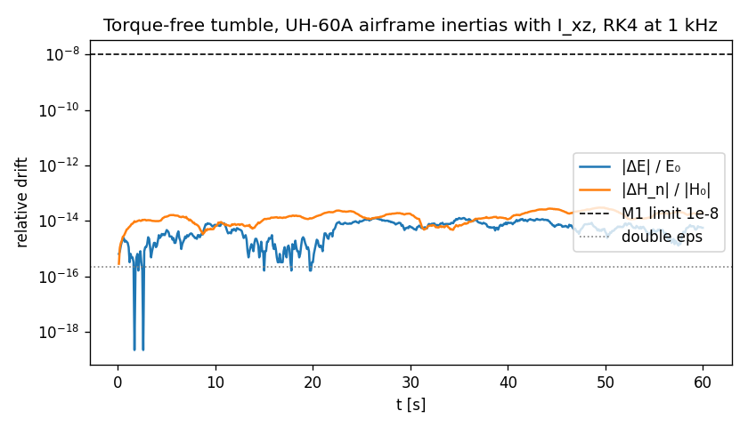
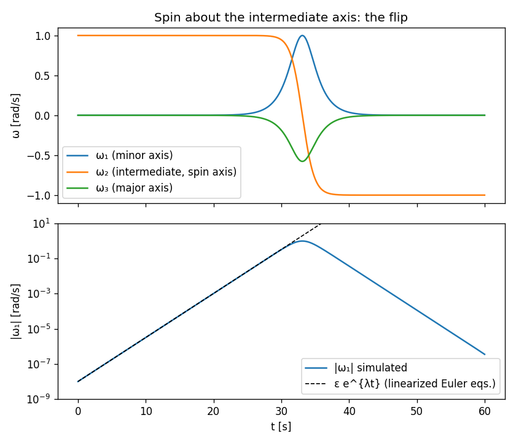
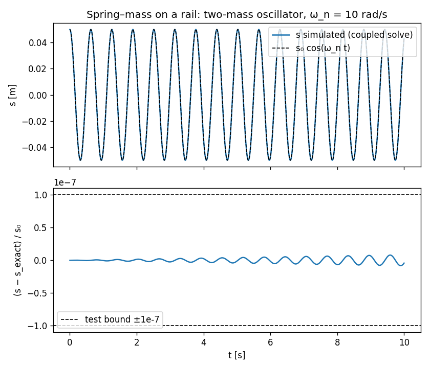
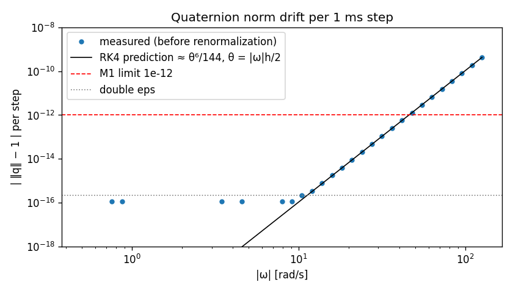

The quaternion plot shows why D-013 was needed. Below about 10 rad/s, the per-step norm drift at 1 kHz is round-off (< 1e-15), so the spec's 1e-12 limit can't detect an attitude error. Above that rate, the drift follows RK4's θ⁶/144.

---

## M2 — Environment and static force stubs (2026-10-10)

The criteria are spec §9 M2 as amended by D-015 (ISA source and model), D-016 (the atmosphere is computed inside Eyas), D-017 (geodetic map) and D-018 (stronger equilibrium test, dummy rotor, public API). The acceptance cases run through the public `eyas::Model` (`include/eyas/model.hpp`) or the production `Executive`. Tests: `tests/unit/test_atmosphere.cpp`, `test_geodesy.cpp`, `test_attitude.cpp` and `test_model.cpp`. Plots: `tests/validation/m2_cases.cpp`, then `tools/plot_m2.py`.

| Acceptance criterion | Status | Evidence |
|---|---|---|
| ISA matches the standard tables at 0, 1000, 5000 and 11000 m | ✅ | `Atmosphere.MatchesUssaGeometricAltitudeTable`, `…GeopotentialAltitudeTable`. The oracle is USSA 1976 Table I, both the geometric-Z and geopotential-H tables (7 rows, human-verified; DATA_GAPS.md). T and ρ agree within ½ unit of the last printed digit. P agrees within 1 unit: see the note below the table. |
| Hydrostatic ISA + ΔT (D-015) | ✅ | `Atmosphere.OffsetAtmosphereIsHydrostatic`: dP/dZ = −ρ g(Z), using USSA Eq. 17 for g, holds to 1e-8 for ΔT = −30, 0 and +25 K in both layers. The code integrates in geopotential altitude, so this is an independent check. Also: sea-level P = P₀ for any ΔT, continuity at the tropopause, and a² = γP/ρ. |
| At rest, dummy force = weight: equilibrium for 60 s | ✅ | `Model.LevelEquilibriumIsExactFor60s`: position and velocity are **exactly** zero after 60 s, which the test asserts. At level attitude the cancellation is exact in floating point (SPEC_REVIEW #17). `Model.TiltedTranslatingEquilibriumHolds` (D-018): a tilted aircraft moving at 9.6 m/s under an inertially fixed balancing force drifts 6.8e-10 m in 60 s, within a 1e-8 m round-off bound. Its velocity error is exactly 0. |
| A step in the dummy force gives the expected vertical acceleration | ✅ | `Model.CollectiveStepGivesExpectedVerticalAcceleration`: collective 0.5 → 0.6 through `advance()` at 60 Hz gives a = 0.2 g up. w(t) and D(t) match the analytic values to round-off (1e-13 m/s, 1e-14 m), since RK4 is exact for constant acceleration. The Tier 1 altitude follows h₀ − D. |
| Tier 1 pose populated; NED-to-geodetic matches a reference calculation at several origins | ✅ | `Model.Tier1PoseMatchesStateAfterResetAndAdvance`. For the geodetic map (D-017), `Geodesy.MatchesEllipsoidArcLengthsAtSeveralOrigins` checks 5 origins (equator; 37° N; 34° S; 65° N at 1500 m; next to the antimeridian). North and east displacements up to 30 km match arc lengths on an independently constructed WGS-84 meridian ellipse, within the predicted second-order bound ½ (dR_M/dφ) Δφ². The radii match NGA Table 3.5 at the equator and the poles (b²/a, a, R_p). Euler angles: `Attitude.*`, round trip against Padfield Eqs. 3A.34–3A.40 over all quadrants. |

**Note on the pressure tolerance.** For all seven rows, the printed pressure equals the USSA equations' value with the last digit *truncated*. Rounding would fail three of them; at Z = 11000 m, Eq. 33a gives 226.9996 mb, printed as 226.99. T and ρ are consistent with rounding. So P is allowed one unit of the last digit, and T and ρ half a unit. This is an inference from the seven rows, not something the USSA document states.

**Also verified:**
- **Atmosphere in models (D-016):** `Model.ModelsSeeAtmosphereAtCgAltitude`. A force model sees ρ, T and a at h₀ − D with the host's ΔT.
- **API (D-018):**
  - `Model.RestoreReplaysBitIdentically`: state and remainder, compared with memcmp;
  - `Model.SnapshotAndRestoreDoNotAllocate`, `Model.RestoreRejectsMismatchedSnapshot`;
  - `Model.ResetSetsStateAndZeroesTime`;
  - `Model.OutputsCarryAdvanceStatus`;
  - config errors are `InitError`s, including a physics rate that doesn't divide 1 s into whole nanoseconds.
- **Real-time rules:** `Model.AdvanceDoesNotAllocate` (including the outputs update) and `Model.RunsAreBitIdentical`.
- **The tests can fail:** six deliberate bugs were planted, and each was caught by the intended test:
  1. no geopotential conversion;
  2. pressure-altitude ΔT convention;
  3. R_M and R_N swapped;
  4. gravity rotated the wrong way;
  5. air evaluated at the origin instead of the CG;
  6. restore ignoring the remainder.

  For bug 4, the spec's level equilibrium test **passed**, and only the D-018 tilted case caught it, which confirms SPEC_REVIEW #17.
- **Builds:** all 118 tests pass with GCC 13.3 (Debug, Release, ASan+UBSan) and Clang 18.1 (Debug). clang-format is clean. clang-tidy is clean, and now also covers `src/core`, `src/env` and `src/rotor` (CI updated).

**Plots** (`docs/validation/m2/`):

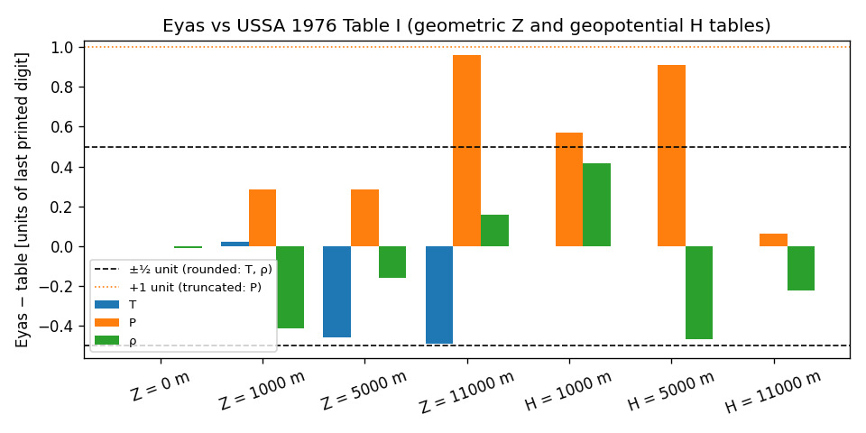
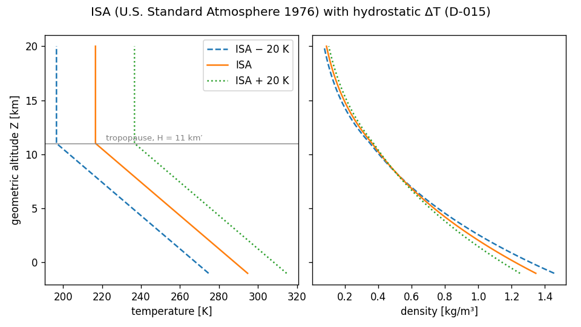
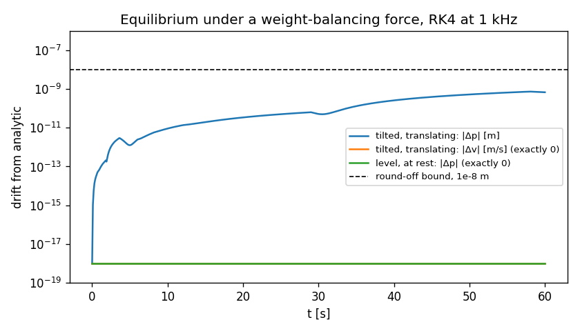
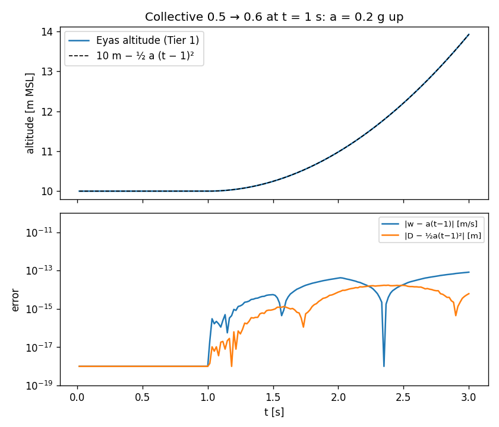

In the profile plot, the ±20 K density curves cross near 8 km. That's expected with a hydrostatic ΔT: a hotter column is less dense at the bottom but holds more pressure aloft.

---

## M3 — Blade-element rotor, rigid blades, uniform inflow (2026-10-11)

The rotor is `src/rotor/blade_element_rotor.*` (with `airfoil.*` and `controls.*`), a `DynamicComponent` with no states: rigid, massless blades with flapping held at zero, and uniform momentum inflow solved in every evaluation (D-024). The criteria are spec §9 M3 as amended by D-007 (layered hover oracle) and D-022 (reference-model comparison as a validation entry). The tests are in `tests/unit/test_blade_element_rotor.cpp` and `test_rotor_inputs.cpp`. The exact-equation reference is `tests/support/bet_reference.hpp`. To reproduce the plots, see `tools/plot_m3.py`. All test rotors and airfoils are synthetic fixtures (`tests/support/m3_fixtures.hpp`): R = 8 m, Ω = 27 rad/s, 4 blades, σ = 0.084, a linear airfoil (C_l = aα, C_d = C_d0) and a nonlinear one with Mach effects, stall and reverse flow. No UH-60A data is used yet (it is transcribed after M3).

| Acceptance criterion | Status | Evidence |
|---|---|---|
| Hover T, Q, P match BEMT within 2%, replaced by D-007: **layer 1**, production code vs an exact-equation reference | ✅ | `HoverPassMatchesExactReference` (fixed λ, uniform and equal-area spacing), `HoverWithSolvedInflowMatchesExactReference`, `TipLossMatchesExactReference`, `ForwardFlightMatchesExactReference` (μ ≈ 0.2, sideslip, climb, wind, body rates, cyclic, hub tilt and offset, both rotation directions), `ReverseFlowAndStallMatchExactReference`. The reference integrates the same equations by adaptive Gauss–Kronrod quadrature, with velocities derived separately in scalar rotating-frame form and Leishman Eq. 3.5 resolution. All six hub load components and λ_i converge at second order, and the Richardson extrapolation from N and 2N elements agrees to ≤ 1e-9 (achieved 7e-11 to 2e-15 at N = 1920–3840). With the nonlinear table (kinks, so no Richardson) the raw error falls as N⁻² to 1.9e-7 at N = 3840. |
| **Layer 2**, the hover closed form (Leishman 2nd ed. Eqs. 3.25, 3.31, 3.32) | ✅ | `HoverMatchesLeishmanClosedForm`: C_T within 1%, C_P within 1.5% and λ within 0.5%, for θ_0.75 = 4–12° with no twist and with −10° twist. The residual is the closed form's small-angle approximation. `ClosedFormResidualVanishesWithInflowAngle` checks the derived bound \|ε_CT\| < (3/2)λ² (with C_d0 = 0) as θ₀ goes from 16° to 1.5°. The discretization error at N = 400 is below 1e-5. |
| **Layer 3**, Knight & Hefner (1937) data (validation entry) | ✅ (entry) | 26 points digitized from Leishman Fig. 3.2 and verified by human review (`tests/validation/reference/knight_hefner_1937.csv`; DATA_GAPS.md). Eyas uses the same assumptions as Leishman's theory curves: untwisted blades, C_lα = 5.73/rad, uniform inflow, B = 1. For θ₀ ≥ 4° it over-predicts thrust by −1% to +16% (mostly +3% to +8%), which matches Leishman's own remark (p. 120) that the theory shows "a slight overprediction of the thrust" because it leaves out nonuniform inflow and tip loss. With an effective-radius tip loss B = 0.97 the difference is −9% to +7%. Below 4° the relative difference is dominated by the ±0.0001 reading uncertainty. No tolerance is applied: this is 1937 data read from a plot (D-007). |
| C_T against collective matches the reference model within 3% (validation entry per D-022) | ⏸ | Needs the UH-60A blade data (transcribed after M3), the license check (SPEC_REVIEW #12) and a reference-model run set up per D-022. |
| T, Q, P at constant collective are steady across azimuth in hover | ✅ | `HoverLoadsAreSteadyAcrossAzimuth`: N_b = 2, 3, 4 and 5, nonlinear airfoil, 97 azimuths. T, Q and P are constant to 1e-12 relative, and the in-plane hub forces and moments vanish to 1e-12. In the plot, the peak-to-peak spread is 0 (thrust) and 3e-16 (torque). |

**Also verified:**
- **Conventions:**
  - `ClockwiseRotorMirrorsCounterClockwise`: the clockwise rotor is the x–z mirror of the counter-clockwise one.
  - `CounterClockwiseRotorLoadSigns`: thrust up, positive torque, the torque reaction yaws the nose right, and in forward flight with no flapping the advancing side rolls the rotor left.
  - `ForwardFlightLoadsHaveBladePassagePeriod`: N_b/rev periodicity.
  - `HubFrameAndBodyTransform`: a forward shaft tilt γ puts z_h at (−sin γ, 0, cos γ). The body pitching moment matches T(x_h cos γ + z_h sin γ) by hand.
  - `AzimuthFromTime`.
- **Inflow solve** (D-024):
  - `InflowSolveConvergesAcrossConditions`: hover, climb, windmill-brake descent, negative thrust and forward flight, each converging in ≤ 10 passes to a root of Padfield Eq. 3.139 within 1e-12.
  - `InflowSolveIsBoundedInVortexRing`: in the vortex-ring region the result stays finite and within the pass limit, and converged results satisfy Eq. 3.139.
  - The descent sweep below converges everywhere in ≤ 14 passes. It also shows momentum theory's vortex-ring gap: the result jumps between root branches at about 3 v_h. Logged as SPEC_REVIEW #21 (open).
- **Inputs:**
  - Airfoil tables must cover α = ±180°, and their columns are checked for dimension (D-021).
  - The linear control map handles offsets, gains and cross-mixing, from config.
  - `Config::path` resolves relative to the config file.
  - The rotor is built from YAML through `eyas::Model`, and config errors name the full key path.
- **Real-time rules:**
  - `AdvanceDoesNotAllocateAndConverges` and `Model.BladeElementRotorFromConfig` check for zero allocations.
  - `DerivativesArePureWithRotor`: bit-identical derivatives despite the cached table-search hints.
  - Convergence flags are counted by the executive (D-023).
- **Cost** (Release, GCC 13.3, WSL2; not the D-005 benchmark, which comes in M8):
  - One rotor evaluation (4 blades × 20 elements, forward flight) takes 11 µs, at 6 blade-element passes per inflow solve.
  - One physics step with the rotor takes about 60 µs, against a ≈ 490 µs worst-case budget per step at 60 Hz (D-005).
  - The atmosphere costs 18 ns per evaluation (about 0.1% of a step), so the deferred M2 review item (caching T₁/P₁ per ΔT) isn't worth doing.
- **The tests can fail:** 13 deliberate bugs were planted in the rotor, and the tests caught every one:
  1. induced-velocity sign;
  2. drag sign in the normal force;
  3. moment cross-product order;
  4. no α wrap;
  5. body transform using C_hb instead of C_bh;
  6. ω × r_hub omitted;
  7. twist looked up at r instead of r/R;
  8. tip loss ignored;
  9. Mach number from U_T only;
  10. body-rate sign in U_P;
  11. cyclic sin/cos swapped;
  12. wind sign;
  13. torque sign.

  The α wrap was first missed: it only matters with upflow in the reverse-flow region, so an upflow case was added. Blade numbering (ψ ± 2πk/N_b) can't be seen in total loads, since the set of azimuths is the same either way; it becomes testable with per-blade states in M4.
- **Builds:** all 155 unit tests and 3 API tests pass with GCC 13.3 (Debug, Release, ASan+UBSan) and Clang 18.1 (Debug). clang-format and clang-tidy are clean.

**Plots** (`docs/validation/m3/`):

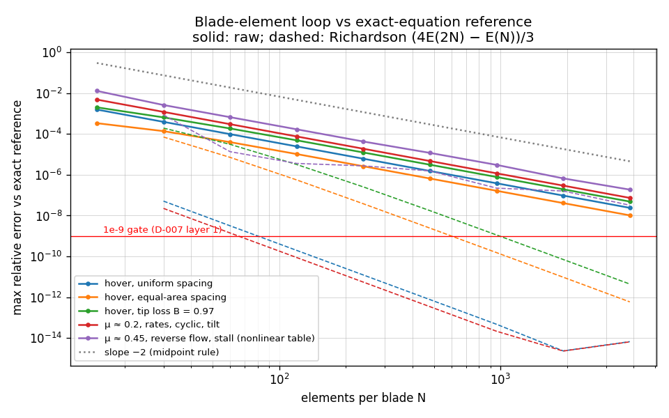
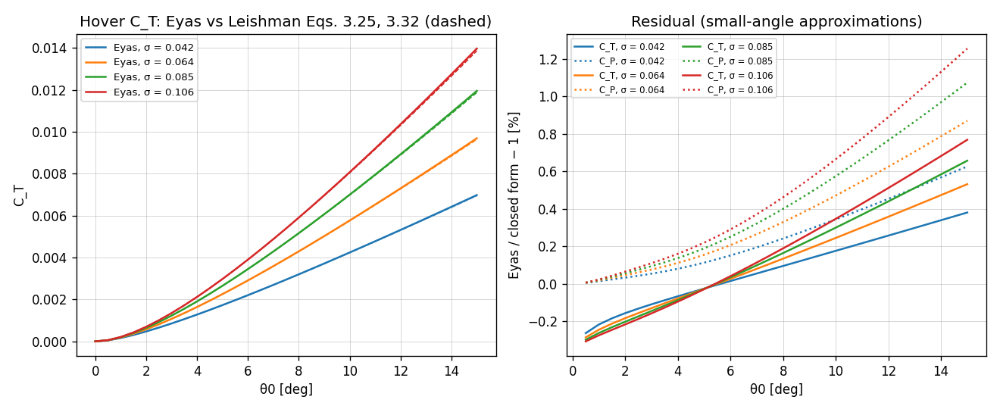
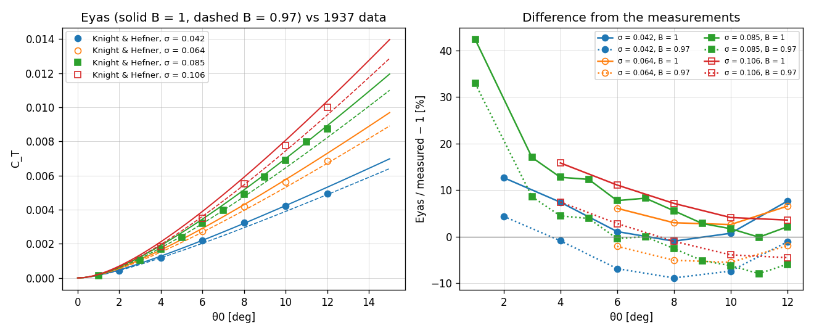
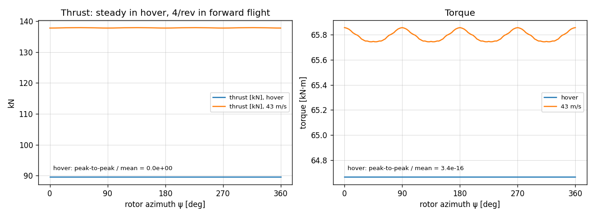
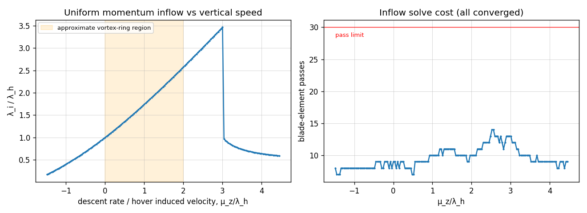

In the refinement plot, the Richardson-extrapolated error of the smooth cases bottoms out at round-off (≈ 1e-15) by N ≈ 2000. The equal-area and tip-loss cases approach second order more slowly, because the equal-area spacing has a larger h⁴ term. The nonlinear-table case has no smooth expansion, so its Richardson curve is erratic, but its raw error still falls as N⁻².

---

## M4 — Individual blade flap dynamics (2026-10-11)

`BladeElementRotor` gains an optional flap hinge (`blade.flap` in config). With it, each blade is a rigid body on an offset hinge, with an optional spring, damper and δ₃. It has states [β_k, β̇_k], and its loads include the blade weight and inertia, split into a = 0 values plus G and H for the coupled solve. Without a flap section the rotor is the M3 rotor, unchanged. Multiblade coordinates come from `src/rotor/multiblade.hpp` (Padfield 3rd ed. Eqs. 3.42–3.45).

The criteria are spec §9 M4, replaced by the D-026 layers (SPEC_REVIEW #22):
- **Padfield's closed forms are for a centre-spring rotor**, so they're used only for e = 0 fixtures; Johnson §6.15 covers the offset hinge.
- The spec's ν_β formula assumes a uniform blade.
- The spec's coning and phase criteria named no formula.

Tests: `tests/unit/test_flapping_rotor.cpp` (layers 1–2) and `test_flap_anchors.cpp` (layer 3). The exact reference is `tests/support/flap_reference.hpp`, the closed forms are in `flap_closed_forms.hpp` and the fixtures in `m4_fixtures.hpp`. To reproduce the plots, see `tools/plot_m4.py`. All rotors are synthetic fixtures with the M3 geometry; the anchor rotor has γ ≈ 8.

| Acceptance criterion | Status | Evidence |
|---|---|---|
| **Layer 1:** production flap equation and hub loads vs an exact-equation reference; G and H vs the full equation | ✅ | `MatchesExactReference`. The reference models each blade as point masses whose NED positions are explicit functions of time, differentiated exactly by Taylor-jet automatic differentiation. Blade directions come from ∂P/∂ψ, ∂P/∂β and ∂P/∂ρ, the flap equation from d'Alembert's principle, and the airframe load is Σ(F − mP̈). Three rotors (both rotation directions; offset or centre hinge; spring, damper, δ₃ = −15…20°; tilted, offset hubs; wind), random attitude, rates, flap states and controls, nonlinear airfoil. For a = 0, each unit vector and a random a: β̈ = ẋ₀ + G·a agrees to < 1e-6 rad/s², and load₀ + H·a to < 1e-7 relative. |
| **Layer 2:** consistent coupling through the production executive | ✅ | `CoupledSystemConservesMomentum`: an airframe (900 kg) tumbling at ≈ 1 rad/s with four flapping blades on springs and dampers, in vacuum, for 1 s. The angular momentum about the system CG and the linear momentum less weight × t are conserved to 7e-9 and 1e-10 at 1 kHz. **The drift falls by 16.0× per halving of the step from 4 ms to 0.25 ms**, which is pure RK4 truncation; a G/H inconsistency would give an O(1) drift that doesn't converge. |
| The non-rotating and rotating flap natural frequencies match ν_β (D-009) | ✅ | `FreeFlapFrequencyMatchesNu`, free response in vacuum, hub at rest, measured from 30 cycles: within 1e-4 of the spec's uniform-blade formula (e = 0.075R), of Johnson Eq. 6.261 for a non-uniform blade with a spring, and of √(K_β/I_β) non-rotating. |
| Hub-motion terms (spec §6.4) | ✅ | `HubMotionForcingMatchesJohnsonAndPadfield`, e = 0 and e = 0.05R: ∂β̈/∂(ṗ, q̇, ẇ) from G and ∂β̈/∂(p, q) by central differences match Padfield Eq. 3.20 (azimuth dependence, Coriolis 2Ω) with Johnson Eq. 16.240's weights (I_β + eS_β)/I_β and S_β/I_β to 1e-7; the u̇, v̇ and ṙ terms are zero. |
| Coning against thrust matches the analytic result | ✅ | `HoverConingMatchesJohnson`: Johnson Eq. 6.277 (μ = 0) plus the weight moment (Eq. 6.208, −0.15° here). The residual is ≤ 0.53% for θ₀ = 4–18° (1% gate). |
| a₁, b₁ against μ match Padfield's analytic expressions at low μ | ✅ | `CentreSpringFlappingMatchesPadfield` (Padfield Eqs. 3.57–3.58, 3.64; λ_β² = 1.12) and `OffsetHingeFlappingMatchesJohnson` (Johnson Eqs. 6.277–6.279). Each closed form is evaluated at Eyas's own inflow, against a fitted periodic solution. Worst component, as a share of the disc tilt: centre ≤ 0.14% and offset ≤ 0.99% up to μ = 0.1 (1.5% gate); 1.7% and 2.0% at μ = 0.2 (3% gate). The residual then grows as expected for expansions that drop the 2/rev flapping: 10.6% and 3.1% at μ = 0.3, reported only (Padfield p. 85 quotes < 10% below μ ≈ 0.35). |
| Flap response to a cyclic step has the expected phase lag | ✅ | `CyclicStepPhaseLag`: a θ₁s step in hover, steady response against 90° − atan(N*/d₁) (Johnson Eqs. 6.278–6.279; Padfield Eq. 3.40 for e = 0). Offset hinge 84.16° vs 84.05°; centre spring 80.23° vs 80.17° (0.3° gate). Amplitude within 0.33% (1% gate). |
| δ₃ coupling (spec M4 scope) | ✅ | `Delta3AddsAerodynamicSpring`: the change in ∂M_aero/∂β matches −I_βΩ²(γ/8) tan δ₃ (Johnson Eqs. 6.303–6.304) within 1% for δ₃ = 15°, 30° and −20°. |
| Coning and a₁, b₁ vs the reference model across the speed range | ⏸ | Validation entries (D-022 pattern). They need the license check (SPEC_REVIEW #12) and a reference-model run of a defined UH-60A isolated-rotor case. |

**Also verified:**
- **Hub force from disc tilt:** `HoverHubForceFollowsDiscTilt`. The mean in-plane hub force, including blade inertia, is C_T·β₁c and −C_T·β₁s (Padfield Eqs. 3.100–3.101) within 3% of the tilt.
- **M3 behaviour kept:** `ZeroFlapReproducesM3Aerodynamics`. All M3 tests pass unchanged.
- **Config:** `Model.FlappingRotorFromConfig` reads GenHel units (`lbm`, `slug*ft`, `slug*ft^2`, and the new `ft*lbf/rad` and `ft*lbf*s/rad`). The config errors name the key: wrong dimension, unknown key, and I_β < S_β²/m_b (Cauchy–Schwarz). `RejectsInvalidHinge` covers the constructor checks.
- **Real-time rules:** `DerivativesArePureAndDontAllocate`, and zero allocations through `Model::advance()` with a flapping rotor.
- **Cost** (Release, GCC 13.3, WSL2): one rotor evaluation in forward flight takes 10.1 µs with flapping and 9.7 µs without.
- **The tests can fail:** 12 deliberate bugs were planted, and each was caught by at least one test:
  1. Coriolis term dropped;
  2. G zeroed;
  3. gravity moment sign;
  4. U_P on the shaft axis instead of the blade normal;
  5. δ₃ sign;
  6. H missing the β̈ coupling;
  7. blade moment missing its span term;
  8. hinge-offset velocity dropped;
  9. induced velocity not projected on the flapped blade;
  10. flap moment arm r instead of ρ;
  11. blade weight missing from the hub load;
  12. the 2Ωβ̇ sin β term dropped.

  Two of them (G zeroed, induced velocity not projected) are caught only by the layer 1 reference. That is why it is a gate.
- **Builds:** all 184 tests pass with GCC 13.3 (Debug, Release, ASan+UBSan) and Clang 18.1 (Debug). clang-format and clang-tidy are clean.

**Plots** (`docs/validation/m4/`):

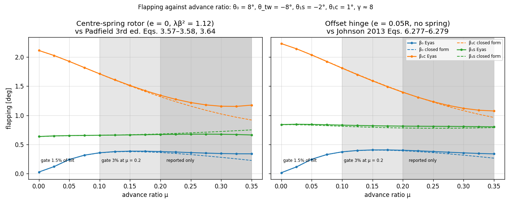
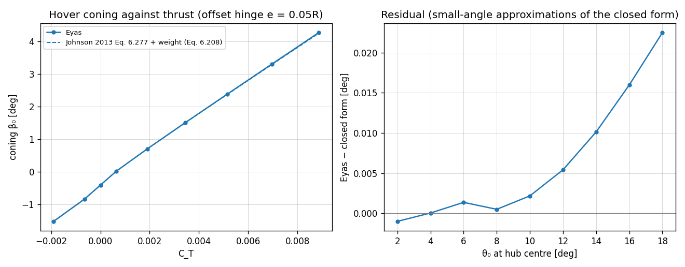
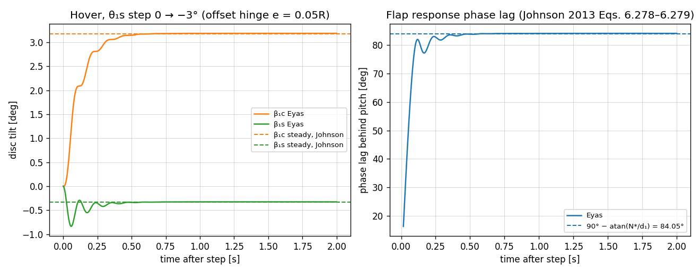
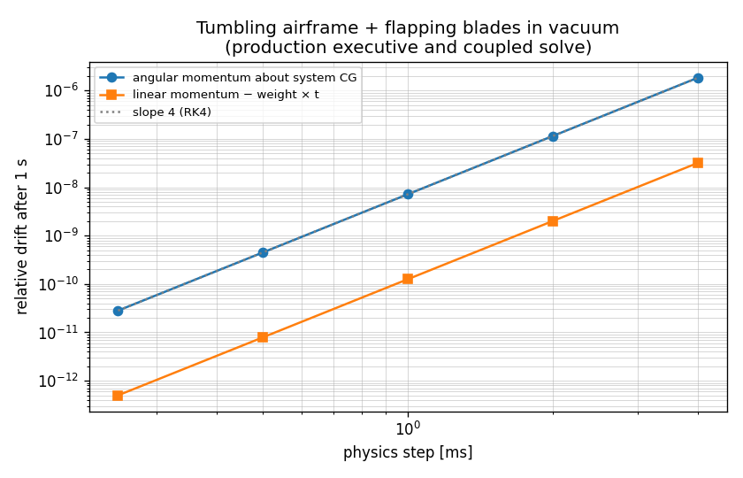

In the cyclic-step plot, the disc settles to the new tilt in about 0.5 s (≈ 2 rev), which matches the flap time constant 16/(γΩ) ≈ 0.07 s per e-fold (Padfield Eq. 3.41). The phase lag converges to Johnson's steady value.

## M5 — Pitt–Peters dynamic inflow (2026-10-12)

`BladeElementRotor` gains `inflow: pitt_peters` (the `inflow:` key is now required, `uniform` or `pitt_peters`). It adds three states [λ₀, λ₁s, λ₁c] after the flap states. The induced velocity varies linearly with radius over the disc, λ₀ + (r/R)(λ₁s sin ψ + λ₁c cos ψ). The states are driven by C_T, C_1s and C_1c from the same blade-element pass, so there is one pass per evaluation and no iteration. The equations are Pitt & Peters 1980 Table 4 in total-state form, with V = √(μ²+λ²) on every column and the wake-skew terms applied in wind axes (`src/rotor/pitt_peters.{hpp,cpp}`; D-027).

The criteria are spec §9 M5, replaced by the D-027 layers (SPEC_REVIEW #10, #23):
- **No value was given for "the published time constant"**, and "the" time constant is ambiguous.
- **The thrust overshoot has a closed form**, so it doesn't need the reference model.
- **The 4× apparent-mass conflict between the sources is resolved in favour of 16/45π.**

Tests: `tests/unit/test_pitt_peters.cpp`. The independent transcriptions of both sources are in `tests/support/pitt_peters_reference.hpp`. To reproduce the plots, see `tools/plot_m5.py`.

| Acceptance criterion | Status | Evidence |
|---|---|---|
| **Layer 1:** the equations against independent transcriptions of both sources | ✅ | `MatchesPittPeters1980AndJohnson2013`. Each source is transcribed in its own notation, state order and load signs: the 1980 Table 4 L and M with (λ0, λs, λc), (C_T, C_L, C_M) and sin α; and Johnson Eq. 11.143 with (λ0, λc, λs), (C_T, −C_My, C_Mx), cos χ and M from p. 437. The wind-axis rotation is done independently, with complex numbers. 204 cases (hover, V = 0, edgewise, windmill, then random μ, μ_z, sideslip and loads) agree to 1e-12. This tests the sign reconciliation of SPEC_REVIEW #10. Also `WakeSkewMatchesJohnson` (X = tan(χ/2), Eq. 11.132) and `RotatesWithTheWind`. |
| **Layer 1:** the production rotor against the M3/M4 exact references with a linear inflow | ✅ | `LinearInflowPassMatchesExactReference`: C_T, C_1s, C_1c and the hub moments, both rotation directions, Richardson-extrapolated, agree to 1e-9 relative. `FlappingRotorMatchesExactReference`: flapping blades, offset hinge, spring, damper, δ₃, tilted and offset hub, random attitude, rates, flap and inflow states. β̈ agrees to 1e-6 rad/s², the airframe load (with G, H) to 1e-7, and the inflow rates (from the reference's own load integrals) to 1e-9; G = 0 on the inflow rows. `InflowRatesUseLoadsFromTheSamePass`: one pass, `converged` always true. |
| In steady state, reduces to uniform momentum inflow in hover (spec) | ✅ | `SteadyHoverEqualsUniformMomentum`: integrated from λ = 0 (no singularity at V = 0) through the production rotor, λ₀ equals the D-024 uniform solve to 1e-9 and λ₁s = λ₁c = 0 to 1e-12, in hover and in a 5 m/s climb, for the linear and the nonlinear airfoil. |
| The inflow time constant in hover matches the published value (spec) | ✅ | `HoverInflowTimeConstants`: with the loading held, τ₀ = (128/75π)/(4λ₀Ω) (1980 Table 4 with eq. 23b; Padfield 3rd ed. Eqs. 5.76 and 5.80 with C₀ = 1), τ₁ = 2(16/45π)/(λ₀Ω) for each first-harmonic state, and no cross-coupling, all to 1e-6. |
| Coupled hover eigenvalues | ✅ | `CoupledHoverEigenvalues`: through the production rotor, rigid blades at fixed pitch, θ₀ = 8°, 12° and 16°. s₀ = −(Ω/M₁₁)(4λ₀ + σa/4) (Leishman 2nd ed. Eq. 3.25; Johnson Eq. 11.148) and s₁ = −(Ω/M₂₂)(λ₀/2 + σa/16) (Johnson Eq. 11.152) agree within 0.5% (1% gate; the residual is the closed forms' small-angle and tip-loss-free assumptions). |
| Step-collective thrust overshoot (spec) | ✅ | `StepCollectiveOvershoot`: a 0.25° step at θ₀ = 12°, hub fixed. The jump (σa/6)δθ₀ agrees within 0.25%, the final value C′ × jump (C′ = 1/(1 + σa/(16λ₀)), Johnson Eq. 11.149) within 1.1%, and the decay rate s₀ within 0.93% (2% gates). The overshoot ratio is 1.71. |
| Wake skew | ✅ | `WakeSkewGradient`: with thrust-only loading, λ₁c/λ₀ = (15π/32) tan(χ/2) (1980 eq. 22b) to 1e-10, and λ₀ = C_T/(2V). `DownwashSkewsDownwind`: through the rotor, the extra downwash sits downwind in forward and sideways flight, for both rotation directions (D-027 wind axes). |
| Stability over the skew range | ✅ | `GainInvertibleAndStableAcrossSkew`: L̂ is invertible and every root is stable for X ∈ [0, 1], with damping ratio ≥ 0.744. **The 1980 paper's "three real, stable roots for all α" doesn't hold for its own Table 4.** The (λ₀, λ₁c) pair is complex for α < 74.6° (SPEC_REVIEW #10 findings; the transcription was confirmed by human review). |
| **Layer 3:** experimental data (validation entry) | ✅ (entry) | Carpenter & Fridovich, NACA TN 3044 (1953), slow collective ramps; see below. |

**Layer 3: NACA TN 3044 collective ramps.**
- **Rotor:** rotor B of NACA TN 1698 on the Langley helicopter tower (3 blades, R = 19 ft, σ = 0.042, NACA 23015). The blade pitch was ramped from 0° to 12° in hover.
- **Eyas setup** (`tests/validation/m5_cases.cpp`): the production rotor with Pitt–Peters inflow, driven by the measured pitch ramp, with the hub fixed and starting from zero inflow, as in the test.
- **Assumptions** (DATA_GAPS.md): constant chord from σ, no root cutout, B = 0.97, a linear airfoil with the Report 824 section lift slope, massless blades, and Ω constant at the initial speed.
- **Spread:** the lift slope ranges over the 0.105–0.110/deg reading and the twist over 0° and −8° (the reports conflict).
- **Tolerance:** none. This is 1953 data read from plots, with an incomplete rotor description (D-007).

Measured against Eyas, for 0° twist and a = 0.1075/deg:

| Fig. 3 case | Peak / steady C_T, measured | Peak / steady C_T, Eyas | v/v_s = 0.9 at, measured | λ₀/λ₀,final = 0.9 at, Eyas |
|---|---|---|---|---|
| (b) ≈ 48°/s | 0.0059 / 0.0045 (1.31) | 0.00634 / 0.00517 (1.23) | 0.65 s | 0.38 s |
| (c) ≈ 20°/s | 0.0053 / 0.0045 (1.18) | 0.00557 / 0.00517 (1.08) | 0.76 s | 0.62 s |
| (d) ≈ 6°/s | 0.00455 / 0.0044 (1.03) | 0.00525 / 0.00517 (1.02) | 1.75 s | 1.83 s |

- **Shape:** Pitt–Peters reproduces the thrust overshoot and the inflow lag, which uniform inflow can't (the dashed lines in the plot: no overshoot, and the inflow follows the pitch). The overshoot grows with ramp rate, as in the test.
- **Steady thrust is 13–22% high** across the spread. Possible contributors: the assumed constant chord with no root cutout; a section lift slope from a 2-D test at a higher Reynolds number; and blade-element momentum theory's known over-prediction (the M3 Knight & Hefner entry shows +3–8% for untwisted blades; TN 3044's authors used an "adjusted" lift slope for this reason). This is a steady-thrust offset, not a dynamic-inflow error.
- **In the faster ramps the overshoot is smaller and the inflow builds up faster than measured.** In the slowest ramp they agree within about 5%. Three possible contributors, none established:
  1. The measured hub thrust includes blade flap inertia and blade bending, which Eyas leaves out here. TN 3044 puts the blade-inertia share at a few percent of thrust for the slower ramps, rising to 38% for the fastest.
  2. v was measured with paddles about 2 ft below the disc, in the wake, which lags the disc inflow. The smoke photographs show the flow building at the tips first and then moving inboard, which a uniform λ₀ can't represent.
  3. The Pitt–Peters apparent mass 128/75π is about 0.64 of the 8/3π used in TN 3044's own calculation, so the Pitt–Peters inflow responds faster.
- **Decision for later:** revisit with the flap DOF enabled if the blade inertia and CG ever turn up (DATA_GAPS.md). If M7/M8 hover heave response is too fast against flight data, the apparent mass is the first thing to examine.

**Also verified:**
- **M3 and M4 behaviour kept:** with `inflow: uniform` the rotor is unchanged, and all M3 and M4 tests pass unchanged.
- **Config:** `Model.PittPetersRotorFromConfig` (3 inflow states after the 8 flap states, zero allocations through `advance()`). A missing or unknown `inflow:` value is rejected with the key path.
- **Real-time rules:** `DerivativesArePureAndDontAllocate`. There's one blade-element pass per evaluation, against 6–30 for the uniform-inflow solve.
- **The tests can fail:** 10 deliberate bugs were planted, and each was caught by at least one test:
  1. skew coupling sign, in L̂;
  2. skew coupling sign, in the rates;
  3. wind-axis sign;
  4. C_1s weighted by cos ψ;
  5. inflow gradient not projected on the flapped blade;
  6. moment apparent mass 64/45π;
  7. thrust apparent mass 8/3π;
  8. V = |λ| instead of √(μ²+λ²);
  9. inflow gradient dropped;
  10. hinge-offset term of the gradient dropped.

  Three of them (5, 8 and 10) are caught mainly by the layer 1 exact reference, so it stays a gate. Bug 1 is caught only by the stability test, because the rate function inverts L̂ in closed form rather than calling `pitt_peters_gain()`. The layer 1 transcriptions cover the rates.
- **Builds:** all 199 tests pass with GCC 13.3 (Debug, Release, ASan+UBSan) and Clang 18.1 (Debug). clang-format and clang-tidy are clean.

**Plots** (`docs/validation/m5/`):

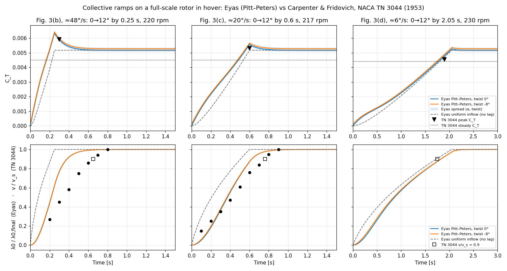
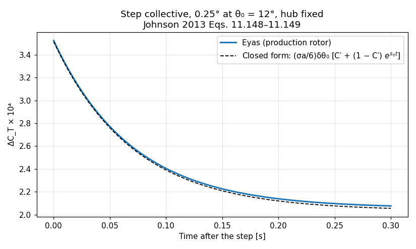

## M6a — Component data path and tail rotor (2026-10-12)

M6 is staged in four steps (D-028). M6a adds:
- **The data path between components (D-003).** A component declares the outputs it produces and consumes, by name (`<instance>.<field>`). At init the executive gives each name a slot in one pre-allocated store and sorts the components so producers run before consumers, with ties kept in config order. A missing producer, a duplicate or a cycle is an init error naming the components. Debug builds fill the store with NaN at the start of every evaluation and assert on a read before the write (`src/core/coupling.{hpp,cpp}`, `src/sim/executive.cpp`). A named `blade_element_rotor` produces λ₀, μ_x, μ_z, β_1c and ΩR.
- **The GenHel tail rotor** (`type: bailey_rotor`, `src/rotor/bailey_rotor.{hpp,cpp}`): the closed-form Bailey thrust of CR-166309 §5.4.2 with tip loss, twist, δ₃ through the coning rate, the pitch bias, fin blockage and drag. Thrust only, as in GenHel. GenHel's previous-pass inflow becomes one Pitt–Peters inflow state, and its previous-pass δ₃ an exact solve in the same evaluation (D-028).
- **Main-rotor wash at an airframe point** (`src/rotor/rotor_wash.{hpp,cpp}`): GenHel's E_KX, E_KZ maps against wake skew χ and flapping a₁, from the rotor's coupling outputs. The tail rotor uses it now; the stabilator and fin will use it in M6b. GenHel's definitions are χ = atan(μ_x/|λ|) + a₁ (p. 5.1-37) and a₁ = −(2/b)Σβ cos ψ = −β_1c (p. 5.1-18).

The criteria are D-028's layers for the tail rotor. The spec's "pedal balances torque" check is in M6d, with the whole aircraft.

Tests: `tests/unit/test_coupling.cpp`, `tests/unit/test_bailey_rotor.cpp`. The GenHel transcription is in `tests/support/genhel_tail_rotor.hpp`. To reproduce the plots, see `tools/plot_m6.py`.

| Acceptance criterion | Status | Evidence |
|---|---|---|
| **Data path:** producers before consumers, values from the same evaluation | ✅ | `Coupling.ProducerRunsFirstWhateverTheConfigOrder`, `ChainsAcrossComponents`: consumers listed before their producers are evaluated after them; ties keep config order. `InitErrorsNameTheProblem`: missing producer, duplicate, cycle. `UndeclaredReadAssertsInDebug`: a read of an undeclared output dies in debug builds. `DerivativesStayPure`, `AdvanceDoesNotAllocate`. |
| **Layer 1:** the tail rotor against GenHel §5.4.2 | ✅ | `MatchesGenHelSteadyState`: GenHel's equations transcribed in GenHel's notation and units (inches, lb, degrees, buttlines positive to port, wind-tunnel-style velocities), with the previous-pass inflow and δ₃ iterated to their fixed point. 300 random cases (forward, rearward and sideways flight, body rates, climb and descent, blockage active and not, interference velocities): with its inflow state at GenHel's converged downwash, production's forces, moments and thrust agree to 1e-10 relative, the blade pitch after δ₃ to 1e-12 rad, and dλ_i/dt = 0 to 1e-10. |
| Sign and arm conventions | ✅ | `HoverThrustDirectionsMatchTheAircraft`: thrust to starboard and 20° up, nose-left yaw moment, hub 14 in to starboard. This confirms the buttline reading in DATA_GAPS.md ("B_LTR sign"). |
| **Layer 2:** Bailey's coefficients are the small-angle thrust integrals | ✅ | `CoefficientsAreSmallAngleIntegrals`: t₃₁ = E[∫|U_T|], t₃₂ = E[∫U_T²], t₃₃ = E[∫rU_T²] over r ≤ B by independent quadrature, to 2e-6, for B = 1 and 0.92 and μ ≤ 0.3. So GenHel keeps reverse flow on the inflow term only, which is the μ²λ term of Johnson (2013) Eq. 6.219. **GenHel's placement of B on the μ² terms is the exact one for lift carried to B·R; Johnson's B³μ², B⁴μ² placement is the approximation.** |
| **Layer 2:** the blade-element rotor against the same integrals with full reverse flow | ✅ | `BladeElementMatchesSmallAngleIntegrals`: the production M3 rotor (exact angles, 4000 elements, a thin-plate airfoil whose lift reverses with the wind) against the integrals with reverse flow on every term. The remaining difference is the small-angle error, measured at 10–43% of the gate G λ²(θ + λ) over B ∈ {1, 0.92}, twist 0° and −18°, μ = 0–0.3 and λ_i = 0.02 and 0.05. |
| **Layer 2:** hover inflow eigenvalue | ✅ | `HoverInflowEigenvalue`: s = −(Ω/M₀)(4λ_i + G t₃₁/(1 + G t₃₂ k)), with k the δ₃ coupling, to 1e-6, with and without δ₃. At B = 1 and δ₃ = 0 this is the D-027 coupled hover root. |
| Wake skew and wash velocities against GenHel | ✅ | `RotorWash.GenHelWakeSkewAndWashVelocity`: χ and a₁ in degrees as GenHel writes them, 200 random rotor states, to 1e-11; wash components and signs on a synthetic map. |
| End to end through the executive | ✅ | `ConsumesMainRotorWashThroughTheExecutive`: a Pitt–Peters flapping main rotor and the tail rotor, tail listed first. The tail rotor's inflow rate equals one computed from the main rotor's states independently of the store, and `advance()` makes no allocations. |
| Config | ✅ | `ReadsConfig`: units, including the new `ft^2` and `deg/lbf`; δ₃ without a coning rate is an error, not a silent zero (D-021). |

**How close is GenHel's Bailey thrust to an exact blade-element integral?** This doesn't gate anything: Eyas reproduces GenHel's model on purpose, and these are GenHel's own approximations. UH-60A tail rotor, θ₀ = 20° at the root, λ_i = 0.05, against the production blade-element rotor with the thin-plate airfoil:
- **In hover** Bailey is low by the small-angle error: −0.12% at λ_i = 0.02, −1.15% at 0.05, −2.2% at 0.06 (the relative figure grows faster as C_T falls).
- **In forward flight** Bailey is high, because it drops the reverse-flow loss on the pitch terms (4μ³/(9π) θ₀ at B = 1): +1.6% at μ = 0.2, +6.0% at μ = 0.3 and +8.8% at μ = 0.35. **The UH-60A tail rotor reaches μ ≈ 0.37 at 150 kt**, so GenHel's tail-rotor thrust there is about 9% higher than an exact blade-element integral would give. If high-speed pedal trim disagrees with flight data in M7, this is a known contributor. The blade-element tail rotor of spec §6.6 ("later", D-008) removes it.

**Pedal step: why the inflow lag is a state.** A 16° → 18° step in commanded pitch, hover, at sea level. GenHel's previous-pass scheme (inflow and δ₃ both from the last pass) and Eyas's state settle to the same thrust, 1034.3 lbf. On the way there:
- **GenHel oscillates from pass to pass**: 1194, 948, 1087, 1005, 1052 lbf, and so on. The sequence is the same per pass whatever the frame length, so at 1 kHz it dies out within about 7 ms, but at 60 Hz the same ±12% oscillation lasts more than 0.1 s.
- **Eyas jumps to 1201 lbf** (the blade pitch acts at once) and decays smoothly to the steady value with the Pitt–Peters time constant, at any frame rate.

This is the effect D-028 removes. GenHel's transient is a property of its integration scheme, not of the aircraft.

**Also verified:**
- **Earlier behaviour kept:** all M0–M5 tests pass unchanged. An unnamed rotor produces no outputs, and components with no declarations keep their config order.
- **The tests can fail:** 9 deliberate bugs were planted, and each was caught:
  1. Johnson's B² on the μ²λ term;
  2. δ₃ through the unblocked thrust;
  3. mass flow without μ;
  4. apparent mass 8/3π;
  5. the sign of the body-rate velocity at the hub;
  6. the sign of a₁;
  7. the sign of the downwash at the point;
  8. evaluating in config order instead of the sorted order (debug: the read-before-write assert; release: 4 tests fail);
  9. an unsigned μ_x.
- **Builds:** all tests pass with GCC 13.3 (Debug, Release, ASan+UBSan on the M6a tests) and Clang 18.1 (Debug). clang-format and clang-tidy are clean.

**Plots** (`docs/validation/m6/`):

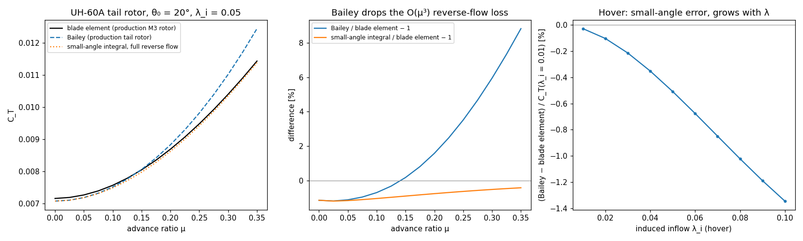
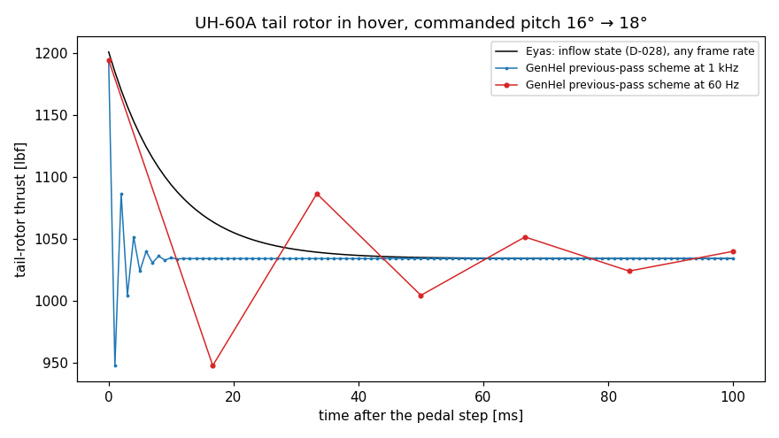

## M6b — Airframe aerodynamics (2026-10-13)

M6b adds the fuselage, stabilator and fin (`type: airframe_aero`, `src/airframe/airframe_aero.{hpp,cpp}`): GenHel CR-166309 §5.2.2 and §5.3.2 with the UH-60A tables (`data/uh60a/airframe/`, built by `tools/build_uh60a_airframe.py` from the transcriptions accepted on 2026-10-13). The delayed fuselage downwash and sidewash at the tail are two lag states (D-028). The wind-to-body rotation follows the flow's actual direction, so drag opposes the flow in rearward flight too (D-030). The tunnel angles α_WF and ψ_WF go to the coupling store for the tail rotor.

The tail rotor now takes the airframe's wake too (GenHel p. 5.4-5): the fuselage's dynamic-pressure factor on its body velocity, and the delayed sidewash and downwash as two more lag states (`fuselage_wake: {airframe: <name>}` in a `bailey_rotor` config). GenHel reads the fin's and stabilator's maps there, so the airframe looks them up once and publishes them through the coupling store (`<name>.fin_q_factor`, `.sidewash`, `.downwash`); the tail rotor has no copy of the tables.

The stabilator follows GenHel's schedule (Fig. 5.1.7 on p. 5.5-18) in its steady state: the airspeed lag settled, no pitch-rate or lateral-acceleration feedback, the servo at unit gain, within the −8°…39° travel (D-028). The schedule is a table in airspeed and collective (`data/uh60a/airframe/stabilator_schedule.csv`) whose grid makes bilinear interpolation exact. GenHel doesn't give the collective input's units; percent of travel is assumed (DATA_GAPS.md). A fixed incidence (GenHel's STBSET) remains available instead.

The two reports D-028 promises are below the table: the lag against an exact delay, and the sensitivity to a lag on a₁.

Tests: `tests/unit/test_airframe_aero.cpp`, `tests/unit/test_tail_rotor_wake.cpp`; the GenHel transcriptions are in `tests/support/genhel_airframe.hpp` and `genhel_tail_rotor.hpp` (now with K_QTR).

| Acceptance criterion | Status | Evidence |
|---|---|---|
| **Layer 1:** fuselage, stabilator and fin against GenHel | ✅ | `MatchesGenHelSteadyState`: GenHel's equations in GenHel's notation and units, reading the raw transcriptions with GenHel's own low/high map lookups. 400 random cases (geometry, density, flight state up to ±45° sideslip, body rates, main-rotor downwash, wake skew and flapping), lag states at equilibrium: every panel's forces and moments to 1e-9 relative, tunnel and panel angles to 1e-12 rad. `MatchesGenHelWithDelayedWake`: 200 cases with the lag states away from equilibrium. Since production reads the merged CSVs, this also checks the merge. |
| Lag states | ✅ | `LagStateRates`: dε_d/dt = (\|u\|/l)(ε − ε_d) to 1e-12, rearward flight included; `derivatives()` reports the same rates and loads as `evaluate()`. |
| **Layer 2:** symmetry | ✅ | `FuselageMirrorSymmetry`: mirror-image flight gives mirror-image loads when the two tables GenHel prints asymmetric are replaced by symmetric stand-ins. `KnownTableAsymmetries`: those asymmetries are in the data (Table 2.5.11 yaw is odd only inside ±30°; Table 2.5.7 lift increment is not even). D-030 corrects D-028's expected parities. |
| **D-030:** drag never adds energy | ✅ | `DragOpposesTheFlow`: with only the drag tables nonzero, the force on the fuselage and each panel opposes the local flow and is parallel to it, over 500 random directions (over 200 rearward). GenHel's own axes fail this rearward: the same test shows its fuselage drag pointing aft while moving aft. `ContinuousThroughZeroForwardSpeed`: loads continuous as V_X changes sign with V_Z ≠ 0. `RearwardFuselageLoadsInLevelFlow`: rearward in level flow the fuselage loads are diag(−1, 1, −1) times the forward ones, forces and moments (the lift, roll and yaw reverse with the drag; D-030). |
| **D-031:** sideward fade (SPEC_REVIEW #27) | ✅ | `SidewardFadeMatchesReference`: 300 random directions within 24° of the sideward line, the reference built from GenHel's equations at angle of attack s·α with the fade applied as D-031 writes it: fuselage loads to 1e-9 relative, bit-identical outside the fade. `ContinuousThroughPureSidewardFlow`: on the line the loads, α_WF and the stabilator's angle and dynamic pressure no longer depend on the direction the flow comes from (the unfaded model spreads by more than 100 N·m). c = 20° from the sweep below. |
| **Ruling A:** fin downwash sign | ✅ | `MainRotorDownwashSameAtStabilatorFinAndTailRotor`: in hover the main-rotor downwash at the stabilator and fin is equal, downward, and equal to what the tail rotor adds (M6a). |
| Coupling, purity, real time | ✅ | `WritesTunnelAnglesToTheStore`; `ThroughTheExecutive`: with a Pitt–Peters flapping main rotor listed after it, the airframe is evaluated second, derivatives are repeatable and `advance()` makes no allocations. |
| Config | ✅ | `ReadsConfig`: the UH-60A CSVs through the config reader give the same loads as the fixture; no placeholders. |
| **Stabilator schedule:** against GenHel's block diagram | ✅ | `StabilatorSchedule.MatchesGenHel`: GenHel's Fig. 5.1.7 evaluated directly from the transcription (steady state), 2000 random cases from 40 kt rearward to 200 kt and collective past both stops: incidence to 1e-12 rad, so the table is exact. `HoverAndForwardFlight`: 39° (the travel limit) in hover and up to 30 kt, 5.214° at 80 kt and 50 % collective (by hand), saturation past 147 kt; the scheduled incidence gives the same loads as the same fixed incidence. `ReadsConfig`: incidence and schedule together is an error. Three planted bugs caught (no travel limit; airspeed magnitude instead of u; the table built without the 70 % breakpoint). |
| **Tail rotor in the airframe's wake:** against GenHel | ✅ | `TailRotorWake.AirframePublishesGenHelsTailRotorWake`: what the airframe publishes is GenHel's K_QTR, SIG_TR and EPS_TR (Tables 3.5.7, 3.5.8, 3.5.4 on PSIWF and ALFWF, GenHel's own map lookups), 300 random cases forward and rearward, to 1e-14. `TailRotorWake.MatchesGenHel`: the M6a transcription with those values and the wake velocities, 300 random cases, forward and rearward, half at the steady state and half with delayed wake: loads and thrust to 1e-10 relative, and the lag rates. `NoWakeIsM6a`: with a neutral wake it is the M6a rotor. |
| Tail rotor, end to end | ✅ | `TailRotorWake.ThroughTheExecutive`: tail rotor, airframe and main rotor listed in that order are evaluated main, airframe, tail; the tail rotor's three state rates equal ones computed from the other two components independently of the store; repeatable; no allocation. `ReadsConfig`. |

**The wake lag against the exact delay (D-028 check).** GenHel delays the fuselage downwash at the stabilator by l/u (l = 28.7 ft from the CG); Eyas uses a first-order lag with the same time constant so that the derivative function stays pure and the M7 Jacobians keep the effect. The check runs the production airframe through a sinusoidal heave (±1.1° angle of attack) from 20 to 150 kt and 0.5 to 10 rad/s, twice: once with its lag state integrated (RK4) and once with the exact delayed downwash fed in as the state. UH-60A tables, stations and stabilator schedule, collective 50 %, sea level, no main-rotor wash.
- *The downwash itself* departs from the delay as expected: in the piloted band (1–5 rad/s) the lag's gain falls to 0.24 at 20 kt and 0.78 at 100 kt, with up to 154° of phase difference at 20 kt and 7° at 100 kt. The simulated ratio matches the analytic e^{jωτ}/(1 + jωτ) to 2.5e-7, so the production lag rate is exact.
- *The stabilator lift barely notices:* in the piloted band the lag changes the lift response by at most **1.1 % in gain and 0.6° in phase** (both at 20 kt), and by at most 0.1 % and 0.25° from 70 kt up. Up to 10 rad/s the worst is 1.4 % and 0.7°. The reason is that the fuselage downwash map is shallow (Table 3.5.4: 0.01–0.08° of downwash per degree of α_WF within ±30°), so the delayed term is a small part of the stabilator's angle of attack; where the lag is worst (low speed), that term is also scaled by the low speed.
- **Decision:** the lag stays; no exact delay buffer is needed (D-028's condition for one was a significant error in the piloted band). Not covered: the fin's and tail rotor's delayed sidewash (the same lag form, with Table 3.5.8's sidewash of at most 1.4°), and flight with main-rotor wash on the tail.

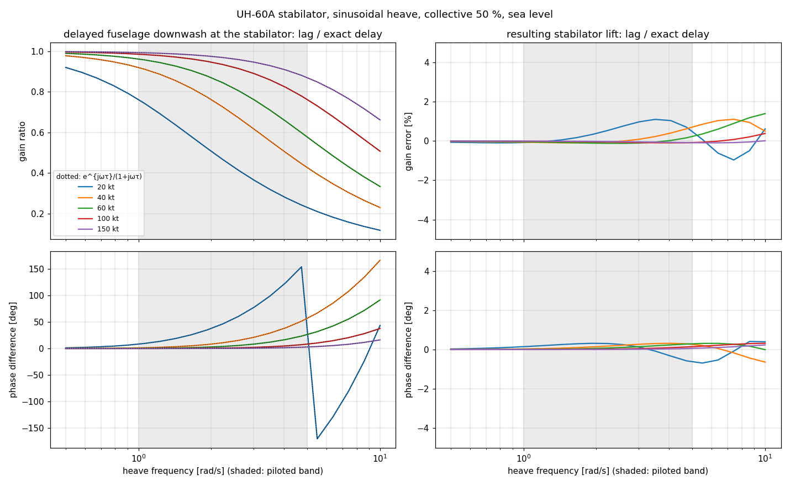

**Sensitivity to a lag on AA1FMR (D-028 "Data rulings").** GenHel's wash maps read AA1FMR, which it never defines; Eyas uses the flapping a₁ itself, with no lag (DATA_GAPS.md M6 item 7). Two numbers bound what an undefined filter could change:
- *How much the stabilator feels a₁.* At level-flight operating points (momentum inflow at the UH-60A's 16 638 lbf, a₁ = 2°), the stabilator lift per degree of a₁, through both wash maps, against its lift per degree of angle of attack: **0.6 to 1.3 from 20 to 60 kt**, 0.33 at 70 kt, and below 0.17 from 80 kt up. At low speed the main-rotor wake sweeps over the tail and a₁ moves it as much as angle of attack does; at cruise it hardly matters. (The curve is uneven at low speed because the wash maps are coarse: 10° steps in wake skew, 6° in a₁.)
- *What a lag would do to that path.* A first-order lag τ on a₁ multiplies the a₁ path by 1/(1 + jωτ): confirmed through the production path (wash maps, airframe and its lag states) to 1e-5 in gain and 2e-5° in phase for τ = 17.5 ms, 50 ms and 0.3 s. **The a₁ path stays within 5 % gain and 5° phase in the piloted band only for τ ≤ 17.5 ms** (the phase is the binding limit, at 5 rad/s).
- For scale, the main rotor's output filter T_FILMR = 0.3 s (p. 5.1-49, read with high confidence; it filters the rotor's forces and moments, p. 5.1-36, and nothing says it filters a₁): on the a₁ path it would mean 17° of lag at 1 rad/s and 56° at 5 rad/s.
- **Conclusion:** if AA1FMR carries any filter longer than about 20 ms, it changes the stabilator's response to flapping noticeably below 60 kt, and not above 80 kt. Item 7 stays open with these numbers. Low-speed pitch response against flight data (M7, M8) is where it would show.

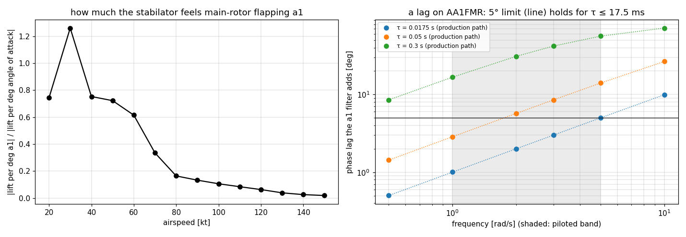

**Width of the sideward fade (D-031, SPEC_REVIEW #27).** On the sideward line (V_X = V_Z = 0) the wind axes are singular, in GenHel too; D-031 fades them into fixed axes within c of the line. The criterion, set before the sweep: within the fade the total airframe loads may change with the flow direction at most about twice as steeply as away from the line (20°–45° from it). Grid of directions 0.05°–20° from the line, all around it, UH-60A tables and stations, no wash, lag states zero (the loads scale with q, so the ratio holds at any speed):

| c | 2° | 5° | 10° | 15° | 20° |
|---|---|---|---|---|---|
| steepest force change / away from the line | 15.0 | 6.2 | 3.2 | 2.2 | 1.7 |
| steepest moment change / away from the line | 19.8 | 7.9 | 3.9 | 2.6 | 1.9 |

So **c = 20°**, not the first guess of 10°. What it costs, as the largest change of each moment around the line at 20 kt (kN·m; the unfaded moments swing by 3.0–3.2 in roll, 4.1 in pitch and 4.3–4.4 in yaw around it):

| Distance from the line | 10° fade: roll, pitch, yaw | 20° fade: roll, pitch, yaw |
|---|---|---|
| 1° | 1.72, 3.27, 3.44 | 1.77, 3.33, 3.49 |
| 4° | 1.54, 3.16, 2.44 | 1.65, 2.96, 3.20 |
| 8° | 0.32, 0.69, 0.76 | 1.53, 3.11, 2.38 |
| 15° | 0 | 0.45, 0.93, 0.94 |

Close to the line any continuous model must change the loads by a large part of their swing, because the unfaded ones swing across that whole range there (dotted curves below); this one changes them by 55–80 % of it at 1°, more than an average would, since level flow from ahead sits near one end of the pitch and yaw swings. On the line the faded loads take the value of level flow from slightly ahead (θ = 0: roll 0.80, pitch −1.13, yaw 3.19 kN·m), the tunnel's sideslip-sweep condition, not the average around the line (0.44, 0.23, 2.25). GenHel's own unexecuted filter (p. 5.2-10) would act up to about 48° from the line at 20 kt.

*Where the fade acts in flight.* The main-rotor wash keeps the flow at the fuselage and tail away from the line. With GenHel's UH-60A wash maps (pure sideward flight, so no wake skew) the flow enters the 20° fade at:

| Rotor thrust | Fuselage | Stabilator and fin |
|---|---|---|
| hover (16 638 lbf, λ₀ = 0.054) | beyond 45 kt sideward | about 35 kt |
| half | about 35 kt | about 20 kt |
| quarter | about 15 kt | about 10 kt |
| none (rotor stopped) | at any sideward speed | at any sideward speed |

So it matters at low thrust and on the ground in a crosswind (M6d, M8). Near the line the panel loads are not credible with or without the fade: GenHel's panels use the full dynamic pressure, spanwise flow included, and its wash maps don't skew the wake sideways. The fade buys continuity there, not accuracy.

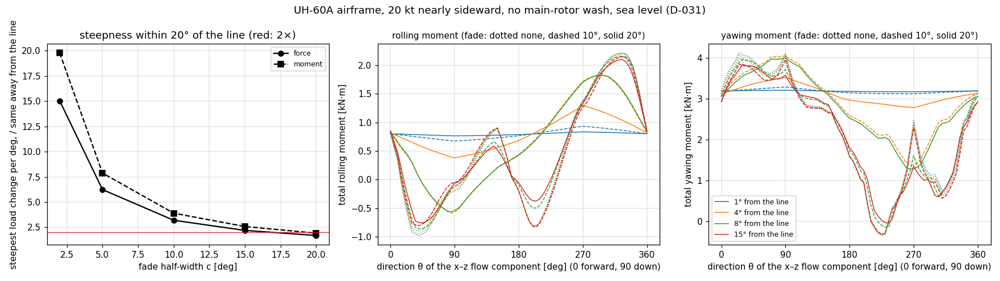

To reproduce: `./build/release/tests/eyas_m6_cases build/m6_cases && .venv/bin/python tools/plot_m6.py build/m6_cases docs/validation/m6`.

**The tests can fail:** 10 deliberate bugs were planted and each was caught: the fin wake sign; GenHel's α for the wind axes (D-030); ψ_WF = +β_WF; the moment arm reversed; K_Q missing on the wake term; K_Q missing on the body velocity; the incidence subtracted; u instead of \|u\| in the lag; no coupling write (debug: the read-before-write assert); the pitching-moment sign.

For the tail-rotor wake, 7 more planted bugs were each caught: the sidewash sign; K_QTR missing on the wake term; K_QTR missing on the body velocity; downwash looked up on ψ_WF; u instead of \|u\| in the lag; the wake state rates not written; the two wake states swapped.

After the code review the tail rotor reads the wake from the airframe; 4 more planted bugs were each caught: the stabilator's K_Q published as the fin's; the sidewash and downwash slots swapped; the undelayed sidewash in the tail rotor's velocity; the store not read.

For the sideward fade (D-031), 7 more: lookups unfaded; a linear fade; the drag faded with the other components; R(α', β) instead of R(0, β) in the fixed term; the weights swapped; cos c instead of sin c; the moments left unfaded.

**Builds:** all 240 tests pass with GCC 13.3 (Debug) and Clang 18.1 (Debug); the M6b tests pass under ASan+UBSan (2026-10-14, after the code-review fixes). clang-format and clang-tidy are clean, and the generated tables match their transcriptions.

## M6c — Landing gear (2026-10-14)

M6c adds GenHel's landing gear (`type: landing_gear`, `src/airframe/landing_gear.{hpp,cpp}`): CR-166309 §5.7, three gears each with a tire in series with an oleo strut and an unsprung mass, with the UH-60A data (`data/uh60a/gear/`, built by `tools/build_uh60a_gear.py` from the transcriptions of §5.7.5; the two doubtful cells verified by human review on 2026-10-14). The wheel brakes are pilot inputs, `Controls::brake_left` and `brake_right` in [0, 1] (an additive public API change; GenHel's set and off at the ends, linear between). GenHel's frame-to-frame memory becomes five states per gear (D-032): the stroke and its rate, the in-plane tire deflection (replacing the retained contact point and its slip reset) and the tire's lagged vertical deflection rate. Friction is GenHel's elasto-plastic law in continuous time, with a smooth blend from breakout to sliding friction; the strut's preload lock becomes a stiff top stop; the unsprung mass feels the body's acceleration and its own weight, so the gear has acceleration coupling (G, H ≠ 0) as the M4 blades do.

New units for the data: pressure (Pa, psi), stiffness (N/m, lbf/in, lbf/ft), linear damping (N·s/m, lbf·s/ft) and quadratic damping (N·s²/m², lbf·s²/ft²).

Tests: `tests/unit/test_landing_gear.cpp`; the GenHel transcription is `tests/support/genhel_gear.hpp`, which reads the raw transcriptions and interpolates them itself, so it also checks the CSV build and production's slicing at the tire pressure.

| Acceptance criterion | Status | Evidence |
|---|---|---|
| **Layer 1:** gear against GenHel | ✅ | `MatchesGenHel`: GenHel §5.7.2 in its own notation and units, 4000 random states (attitude ±3°, any heading, CG position, ground height, strokes in both damper regimes, in-plane deflections, body velocity and rates), the retained contact points and filtered rates set to match production's states: tire forces in body axes, slip flags, strut forces, GenHel's δ̈ and the CG loads to 1e-9 relative, with K_SLIP = 1 (over 3000 contacts and 500 slipping axes compared). `MatchesGenHelSliding`: GenHel's K_SLIP = 0.85 with every contact point faster than v_s, so production's limit is the sliding one. D-032 item 7's terms (the wheel's weight and inertia) are set aside by name. Compared only inside GenHel's tables (beyond them GenHel's map clamps, production extends the last slope) and away from three touchdown edge cases listed in the transcription's header. |
| Acceleration coupling (D-032 item 7) | ✅ | `AccelerationCouplingIsDAlembert`: load0 + H a and s̈0 + G a against d'Alembert's principle for each wheel written independently (tire force + weight − m a_P), 200 random states and accelerations, to 1e-9. |
| **Layer 2:** static load split | ✅ | `StaticLoadSplit`: the full gear settled on level ground (with a test-only body dashpot that vanishes at rest), with and without a lift of half the weight: the three normal loads equal the statically determinate closed form (wheel weights at their axles) to 1e-6 of the weight; they sum to weight minus lift. |
| **Layer 2:** energy | ✅ | `DropConservesEnergy`: one gear under the CG, damping and friction off, dropped from 0.3 m carrying a third of the weight: kinetic (airframe and wheel) + gravity + lift + strut (isothermal, and the stop) + tire energy is conserved to 7.7e-4 of the exchanged energy at 1 kHz and 5.7e-6 at 8 kHz (plot below): the model is conservative, and RK4's error comes from the kinks. Pure heave: no rotation to 1e-12. |
| **Layer 2:** slope | ✅ | `SlopeHoldAndSlide`, every wheel braked (synthetic layout): at 0.8 atan μ (24.8°) every tire sticks for 10 s and the mean position moves less than 0.1 mm between two 5 s windows; at atan μ + 3° (34.0°) the slide accelerates at 1.3311 m/s² against g(sin α − K_SLIP μ cos α) = 1.3306. |
| Preload (D-032 item 6) | ✅ | `PreloadPassThrough`: with 75 % lift the mains carry about 1700 lbf, under their 3000 lbf preload: the stroke stays within 0.1 in of the stop and the strut passes the tire load less the wheel's weight, to 1e-6. Without lift the strut strokes and carries the load on the air spring. `DefaultTopStop`: 43 333 lbf/in for the main gear (10 × the 140 psi slope of Table 7.5.3), critically damped. |
| Lift-off (D-032 item 1) | ✅ | `LiftOffClearsDeflection`: off the ground δ' = −δ/G exactly. `UnloadedAxisRelaxes`: an in-plane axis with no stiffness (the tail tire's √F law with the vertical force clamped at zero in a rebound) relaxes the same way instead of following v_c. |
| Turning axes, vertical lag (D-032 review fixes) | ✅ | `StickingDeflectionIsEarthFixed`: while sticking, δ' − v_c = ψ̇ (δ_y, −δ_x) on level ground, with ψ̇ from Padfield 3rd ed. Eq. 3A.42, to 1e-12. `DampingLagRestsOffTheGround`: off the ground the lagged rate decays to zero instead of tracking the closing rate. `DampingLagSeesExactDeflectionRate`: the lag's input equals a central difference of ΔZ along the state's own motion (translating, turning, stroking, deflected) to 1e-7 m/s. |
| Brake inputs (D-032 notes) | ✅ | `BrakeInputs`: `Controls::brake_left` and `brake_right` act on their own main wheel only; k_B is N_BRK at 0, B_RK at 1 and linear between; inputs outside [0, 1] clamp and NaN counts as released; the tail wheel stays at N_BRK. The GenHel comparison draws a random brake input in [0, 1] per state (GenHel at the ends, the linear blend between). The validation data are bit-identical to the run with the earlier config switch. |
| Friction blend (D-032 item 2) | ✅ | `FrictionLimitBlend`: breakout at rest, K_SLIP of it from v_s up, the smoothstep between, monotone; the tail wheel always at N_BRK. |
| Wheel hop at 1 kHz | ✅ | `WheelHopRk4Accuracy`: the stroke history of a released main gear agrees with a 10 µs solution to 1e-3 of its swing over 0.2 s. |
| Purity, real time | ✅ | `PureAndAllocationFree`: repeat evaluations bit-identical, no allocation. `RestoreMidSlideIsBitIdentical`: snapshot and restore in a 35° slide reproduce the run bit for bit. |
| Config | ✅ | `ReadsConfig` (the UH-60A gear through the reader; the 140 psi slice of Table 7.5.3 is bilinear), `RejectsInvalidConfig`, `Units.GearUnits`. |

Planted bugs, each caught: the in-plane forces' moment arm at the axle instead of the contact point; the G row's sign; the wheel's weight left out of s̈; the slip relaxation's sign; no relaxation off the ground. After the review fixes, each fix reverted on its own and caught by its test: the turning term in the stick rate; the lag running off the ground; Ċ_bg left out of the lag's input; an unstiff axis sticking.

**Drop of the full gear.** 0.3 m (2.4 m/s at touchdown), the 7000 kg test airframe level, brakes set. The mains peak at 14.8 klbf and stroke 10.7 in; the tail strokes 16.4 in. The heave settles in about 1.5 s; the tail strut's pitch oscillation is still going at 3 s, because its damper (66.72 lbf·s²/ft², ∝ ṡ²) gives almost nothing at small stroke rates. That is GenHel's data, the slow settling D-032 flags for M6d.

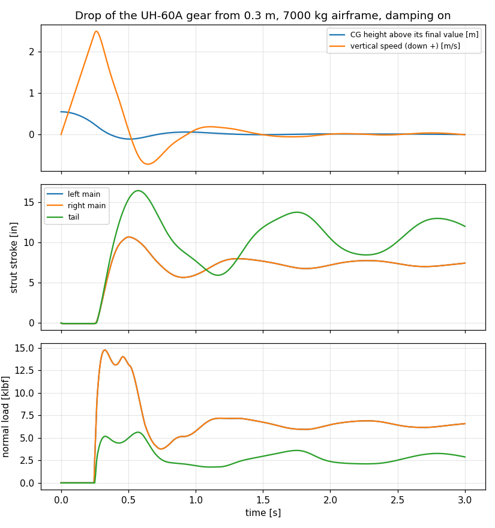

**Energy against the step.** Damping and friction off: the drift falls by 130× from 1 ms to 0.125 ms and then stops at about 6e-6, the test's own quadrature of the tire energy.

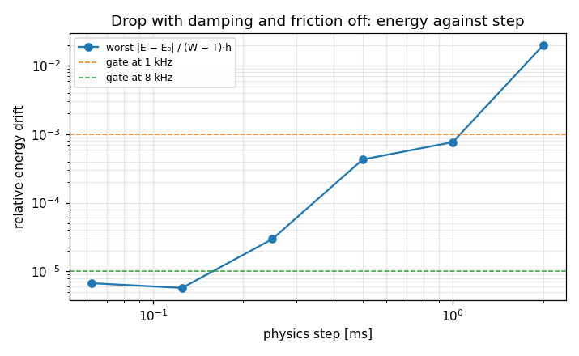

**Slope hold and slide.** Every wheel braked; the hold settles in about a second and then oscillates by ±0.3 mm around a fixed point (the rocking on the tires); the slide follows the sliding-friction parabola.

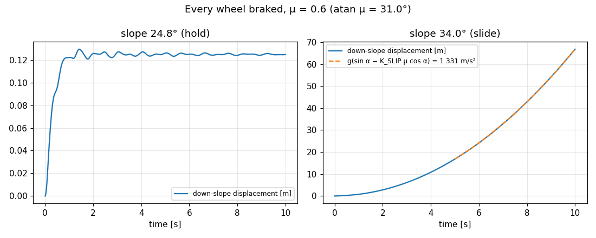

**Brakes off.** Rolling from 2 m/s on level ground, every tire's fore-aft limit is N_BRK μ N and sliding, so the speed falls at K_SLIP N_BRK μ g: 0.0501 m/s² measured over 5 s against 0.0500. (GenHel's rolling resistance is this friction model with N_BRK = 0.01; there is no separate rolling term.)

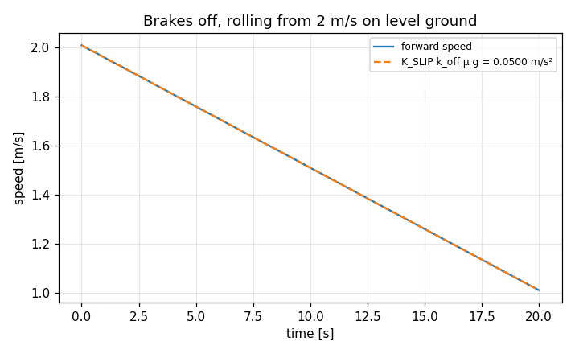

**Sensitivity to v_s (D-032 item 2).** A braked stop from 4 ft/s on the full gear: the distance to rest changes by 0.4 % between v_s = 0.01 and 0.3 ft/s and by 4.6 % at 1 ft/s. v_s = 0.1 ft/s is in the flat part. No case chatters.

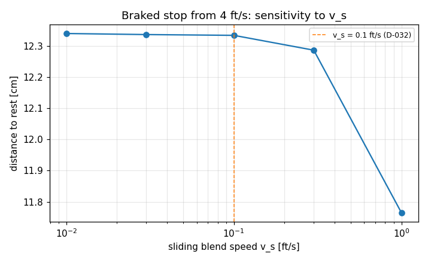

**Builds:** all 262 tests pass with GCC 13.3 (Debug) and Clang 18.1 (Debug); the M6c tests pass under ASan+UBSan. clang-format and clang-tidy are clean, and `tools/build_uh60a_gear.py --check` matches the CSVs to the transcriptions.

## M6d — The UH-60A aircraft (2026-10-14)

M6d puts the UH-60A together from data (D-034):
- the blade-element main rotor with flapping blades and Pitt–Peters inflow (M3–M5);
- the GenHel tail rotor (M6a), airframe aerodynamics (M6b) and landing gear (M6c).

The config is `data/uh60a/uh60a.yaml`, written by `tools/build_uh60a_config.py` from the GenHel transcriptions (new: main- and tail-rotor constants, airframe stations, mass properties and the control rigging of §5.5).
- **Mass:** GenHel's weight and CG are the whole aircraft's. The airframe excludes the blades and the unsprung masses, which carry their own weight. Its CG lies 1.03 in aft of and 3.61 in below GenHel's, and every position in the config is measured from it.
- **Controls:** the controls follow GenHel's mechanical mixing and swashplate phase. The stick and pedal travels were placeholders in M6d; since M7a they come from GenHel's cockpit figures (Figs. 6.3.1 and 6.4.1; D-035), with neutral longitudinal cyclic uncertain by 0.8 in. The hover controls below are also given in GenHel's inches and degrees.

This completes M6.

Tests: `tests/unit/test_uh60a_aircraft.cpp`. The harness in `tests/support/m6d_fixtures.hpp` evaluates the config's components one by one, with the body held, so the checks can read each component's loads. It stops on any unconverged component evaluation (D-023).

*Deferred to M7:* the harness repeats the executive's producer-first ordering and its `SimContext` setup, because the executive offers only the free-body derivative function. Trim (spec §6.8) needs the same held-body evaluation with per-component loads. Its first step adds that to the executive (with a DECISIONS entry), and the harness then wraps it instead of copying.

| Acceptance criterion | Status | Evidence |
|---|---|---|
| Config | ✅ | `ConfigLoadsWithTheDeclaredPlaceholders`: the model loads through `Model::from_file`, and the placeholders are exactly the main rotor's two cyclic offsets (neutral longitudinal cyclic, D-035) and the strut top stops (D-032). `tools/build_uh60a_config.py --check` matches the YAML to the transcriptions (in CI). |
| Mass and geometry (D-034 items 2, 3) | ✅ | `MassSplitKeepsGenHelsWeightAndCg`: airframe + blades + unsprung masses = 16 638 lbm to 1e-5 lbm. Their CG is GenHel's to 1e-5 in, placed from the config's hub and GenHel's station differences, not from the generator's arithmetic. The shaft leans forward 3° with no lateral component. |
| **Layer 1:** control rigging | ✅ | `ControlMapsAreGenHelsRigging`: GenHel's Figs. 5.1.6(a)–(d) and the p. 5.5-20 gains, test-side in inches and degrees, through the travels of Figs. 6.3.1 and 6.4.1 and the p. 5.1-24 blade-pitch equation with the swashplate phase. Blade pitch matches at 12 azimuths and the tail-rotor command matches, both to 1e-7°, for 200 random inputs. The directions are those of `Controls`. |
| **Whole aircraft:** pedal balances torque (D-028 3b) | ✅ | `HoverPedalBalancesMainRotorTorque`: out of ground effect, body held level and at rest, cyclic centred, a root search sets collective and pedal for zero vertical force and zero yaw moment. The tail rotor's force is along its 70° cant (to 1e-12), and its moment is r × F with r from GenHel's stations (to 1e-9). That hand-worked yaw moment balances the other components' to 1 N·m. The main rotor turns the airframe nose right; the tail rotor pushes right and nose left. |
| **Whole aircraft:** sits stably on the ground (D-028 3a) | ✅ | `SitsStablyOnTheGround`: dropped level from 0.3 m with collective down, brakes set and the pedal that balances yaw at that collective. Averaged over 15–20 s, the ground normal loads equal weight minus aerodynamic lift within 0.2 % (2e-6 over 30–40 s in the validation run). It doesn't creep: under 5 mm and 1e-4 rad of heading between the 5–10 s and 15–20 s windows. |
| Gear sides and brakes | ✅ | `MainGearSidesMatchTheirBrakes`: `left_main` at y = −53.2 in (port) with the left brake, `right_main` at +53.2 in with the right brake, the tail wheel on the centreline and unbraked (GenHel p. 5.7-9; p. 5.7-10's missing minus, DATA_GAPS.md). `OneBrakeTurnsTowardsItsSide`: rolling at 3 m/s from tire contact, collective down, pedal balanced. Against the same run with no brakes (0.017° drift in 1.5 s), the left brake alone turns the nose 0.083° left and the right brake 0.090° right; the test asks for more than three times the drift. (With M6d's placeholder travels the aircraft sat 1.1° less nose-up, with less load on the tail wheel, and turned 0.26° and 0.51°.) The tire side forces take most of the brake's yaw moment, the non-castering tail wheel's above all (D-032 item 10). |
| Real time | ✅ | `RealTimeRules`: the whole aircraft through `Model` at 60 Hz host frames. The window from 0.2 s to 0.53 s takes in the first tire contact (asserted: no gear load at its start, load at its end). Over it: no allocation in `advance()`, a bit-identical repeat run, and an exact snapshot and restore. |

Planted bugs, each caught: the tail rotor on the port side (BL sign); the main gears' names and brakes swapped (the generator's former BLMGA sign, caught by both gear-side tests); the shaft tilted aft; a wrong blade mass; the tail-rotor cant flipped; the swashplate phase's sign; the sign of the pedal-to-longitudinal-cyclic mixing.

**Hover out of ground effect.** ISA sea level, 16 638 lbm, body held level and at rest, cyclic centred, from `eyas_m6d_cases`:

| Quantity | Value |
|---|---|
| Collective | 0.488 (XC 4.88 in), θ0 = 17.71° at the cuff |
| Pedal | −0.386 (XP 1.65 in), tail-rotor command 20.57°, pitch after δ₃ 25.49° |
| Main rotor | thrust 16 627 lbf, torque 31 840 ft·lbf, 1563 hp |
| Tail rotor | thrust 1058 lbf |
| Yaw moments | main rotor +31 114 ft·lbf, tail rotor −31 076, airframe −37.5; sum −2e-3 |

The thrust exceeds the weight by the airframe's download and the tail rotor's downward component. The main-rotor power gives a figure of merit of about 0.76 against ideal momentum power, in the usual range for a hover rotor. The tail rotor has no power model (DATA_GAPS.md). Since M7a (D-035) these use GenHel's travels. With M6d's placeholders the same check gave 16 753 lbf, 32 290 ft·lbf and 1585 hp: centred cyclic was a different disc tilt (centred cyclic is not a trim; M7 trims it).

There is no published UH-60A hover control position in the library yet. This is a validation entry for M7, not a gate. The comparison will also bring in the deferred elastic twist, rotor-force filter and profile-drag correction (D-034 item 5).

**Drop and settle.** Level from 0.3 m: collective down, brakes set, pedal −0.310 (the yaw balance at collective down). The rotor at flat pitch still lifts 570 lbf. After 30 s the gear carries 16 068 lbf, against weight minus lift of 16 068 lbf. The aircraft sits at 0.83° nose up and 0.08° right wing down; the main rotor's side force and the tail rotor's thrust both act on the airframe. The heading moves by 0.0046° after the first 5 s. (With M6d's placeholder travels, centred cyclic tilted the disc differently and the aircraft sat at 0.26° nose up and 1.10° right wing down.)

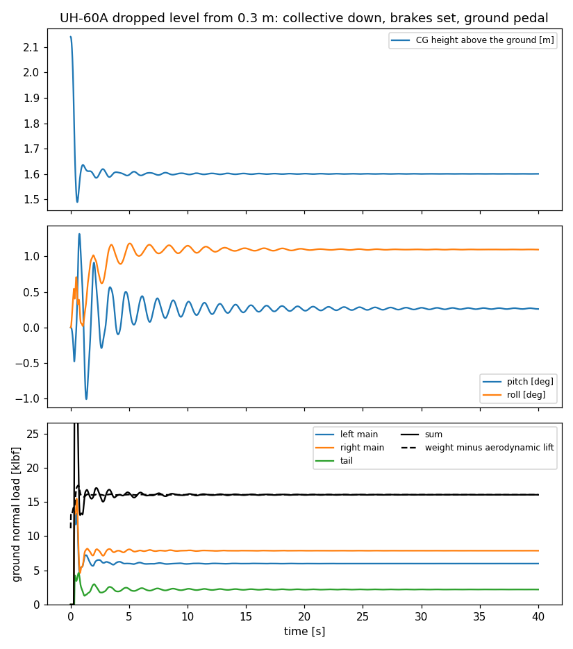

In M6d, at 1.10° right wing down, the right main carried more than the left (35.0 against 26.7 kN at the end); now the aircraft sits nearly level. Before the gear-side fix the plot's two main-wheel curves were labelled the wrong way round. The run itself was bit-identical, since both mains have the same data and both brakes were set.

**The rocking D-032 warned of.** After the drop the aircraft rocks in pitch at 0.9–1.0 Hz. The motion halves about every 5 s (ζ ≈ 0.02): RMS pitch rate 0.66°/s over 5–10 s, 0.14 over 15–20 s, 0.019 over 35–40 s (M6d, with the placeholder travels: 0.7–0.8 Hz, 0.54, 0.14, 0.023). This is the pitch mode on the struts and tires: the strut dampers (∝ ṡ²) give almost nothing at small stroke rates, as GenHel's data have it. It is not D-032's 13.5 rad/s fore–aft mode, which stays quiet here.

The roll rate levels off at about 0.006°/s peak at 17.2 Hz (0.046°/s in M6d, with the placeholder travels' larger disc tilt). That is exactly 4Ω: the main rotor's blade-passage vibration, not an instability.

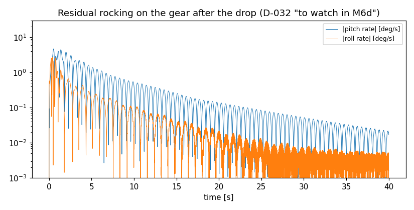

**Cost.** The whole UH-60A takes 13 µs per 1 kHz physics step (Release, GCC 13.3, WSL2; 20 000 steps in hover). This is not the D-005 benchmark, which comes in M8.

**Builds:** all 270 tests pass with GCC 13.3 (Debug) and Clang 18.1 (Debug). The M6d, Model and Executive tests pass under ASan+UBSan. clang-format is clean; no `src/` file changed, so clang-tidy is as before.

## M7a — Trim (2026-10-15)

M7a adds the periodic trim (D-035): `Model::trim()` finds the four controls, pitch and roll, and every rotor, inflow and lag state at azimuth zero for steady straight flight. Over one rotor revolution the body is held at the flight condition while the other states are integrated through azimuth (RK4 at T/256). The trim is solved by Newton's method on all unknowns together, with a finite-difference Jacobian kept between iterations by Broyden's update and rebuilt only when progress stalls: the force and moment on the held body average to zero over the revolution, and every other state returns to its start value. The free body is then started on its own 4/rev vibration cycle (below).

Also in M7a:
- the control travels from GenHel's cockpit figures (D-035; M6d above updated);
- `Executive::held_derivatives`, the evaluation trim needs. The M6d test harness now wraps it instead of copying the executive (its validation output is unchanged);
- the config readers in `sim/build`, shared by `Model`, the tests and the tools.

Tests: `tests/unit/test_trim.cpp`; held evaluation in `tests/unit/test_executive.cpp`; data from `eyas_m7_cases`, plots from `tools/plot_m7.py`.

| Acceptance criterion | Status | Evidence |
|---|---|---|
| **T1** trim converges, 0–150 kt (spec) | ✅ | `Uh60aTrimsFromHoverTo150Knots`: level flight at ISA sea level, 16 638 lbm, every 10 kt, each from the previous trim, in 4–5 iterations; ±1000 ft/min at 60 and 100 kt, ±10° sideslip at 60 kt and 150 kt from a cold start all within the test's limit of 10, the cold start to the same trim as the sweep (1e-6). Net force below 1e-7 of the airframe weight, states periodic to 1e-8. Each body state has the condition's airspeed, sideslip and flight-path angle to 1e-9; a climb takes more collective than level flight and a descent less. |
| **T2** free flight from trim | ✅ | `Uh60aFliesOnFromTrim`: from trims every 30 kt, `Model::advance` at 1 kHz for four revolutions. The body's mean accelerations stay below 5e-5 m/s² and 2e-5 rad/s² up to 60 kt (measured ≤ 5.4e-6 and 1.3e-6), and below 2.5e-3 m/s² and 1e-3 rad/s² from 90 to 150 kt (measured ≤ 1.2e-3 and 2.8e-4). See the drift study below. |
| Independent of the step | ✅ | `IndependentOfTheIntegrationStep`: T/512 against T/256 at hover and 120 kt changes the controls by under 1e-6 of travel and the attitude by under 2.7e-6°. |
| Independent of heading and steady wind | ✅ | `IndependentOfHeadingAndSteadyWind`: at 30 kt, a 1.2 rad heading, and a 30 kt headwind (a hover over the ground), give the same controls (1e-6) and attitude (1e-6°). |
| Body-state geometry | ✅ | `BodyStateHasTheConditionsAirVelocity`: 500 random conditions, attitudes and winds. |
| Held evaluation is the free one at a = 0 | ✅ | `Executive.HeldEvaluationIsTheFreeOneAtZeroAcceleration`: with known G and H, (M_rb − H) a_free equals the held net wrench, and the held component rates are the free ones less G a. No allocation. |
| Model API, real-time rules | ✅ | `ModelStartsFromTrimAndKeepsTheRealTimeRules`: `trim()` resets to t = 0 at the trimmed state; then `advance()` allocates nothing and repeats bit-identically from a snapshot. `RejectsInvalidInputsAndLeavesTheModel`, `UnconvergedTrimIsReported`. |

**The UH-60A trim.** ISA sea level, 16 638 lbm, every 10 kt (`m7_trim.csv`):

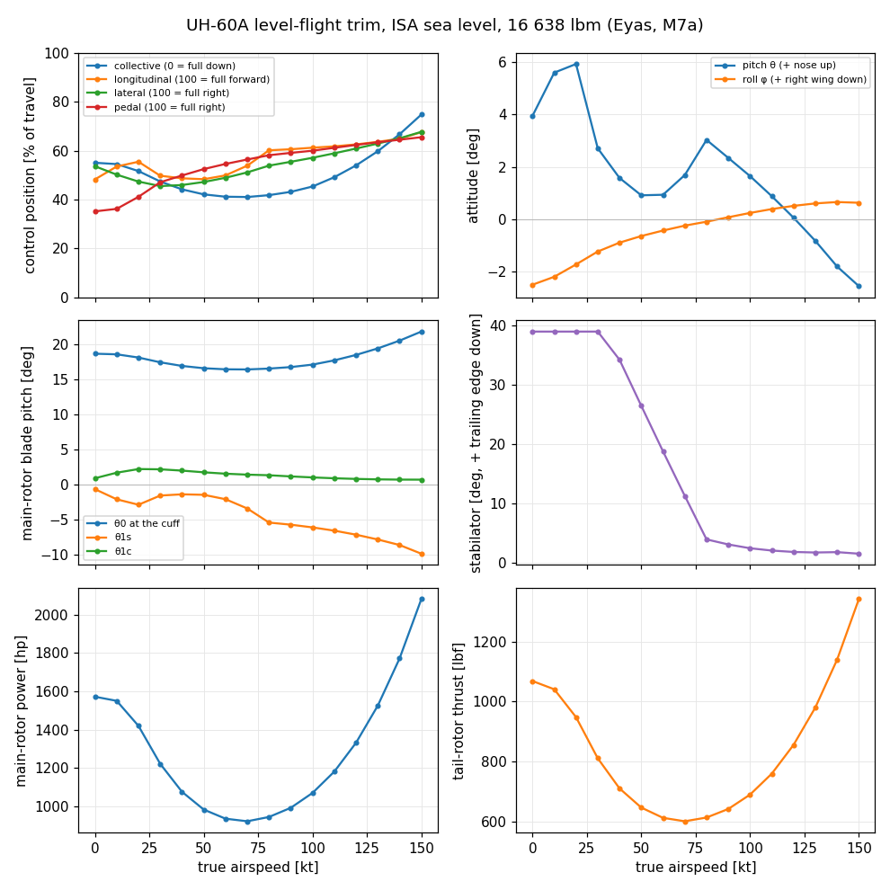

- *Hover:* 4.0° nose up and 2.4° left wing down. The tail rotor pushes right, so the disc tilts left to balance it: the UH-60's familiar left-wheel-low hover.
- *Power:* the main rotor needs 1535 hp in hover, 873 hp at the bottom of the power bucket at 70 kt, and 1882 hp at 150 kt (1890 hp before D-036; M7b below). The tail rotor has no power model (DATA_GAPS.md).
- *Pitch attitude and longitudinal cyclic:* not monotonic. The attitude rises from 0.9° at 50 kt to 3.4° at 80 kt, while the stabilator schedule (D-028) sweeps from 39° trailing edge down at 30 kt to 2.6° at 80 kt. As the stabilator's download falls, the nose comes up. Whether the real aircraft does this is the first question for the comparison with flight test (Ballin, NASA TM-88360, in M7c); the stabilator schedule's collective input scale is still an assumption (DATA_GAPS.md).
- The controls in percent depend on the travels; neutral longitudinal cyclic is uncertain by 0.8 in (8 % of travel), which shifts the longitudinal curve, not its shape.

None of this is compared with data yet: that is M7c.

**Drift study: why the free aircraft doesn't stay exactly in trim.** The trim holds the body still for a revolution. The free aircraft's airframe vibrates at 4/rev (VALIDATION.md M6d), which a held trim leaves out. Measured from each trim (`m7_drift.csv`):

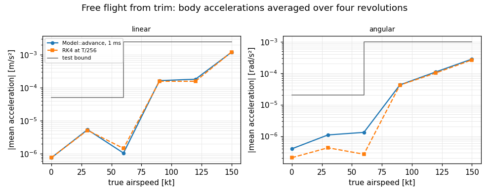

- *Starting on the vibration cycle.* Started from the held trim with zero vibration, the free body is off its vibration cycle by a small rate (about 0.006 rad/s in roll at 150 kt), and the roll damping reacts to it: 0.011 rad/s² of mean roll acceleration over the first revolution at 150 kt. The trim therefore adds to the start state the zero-mean velocity and rate oscillation that the free-body accelerations along the held orbit imply (`Problem::vibration`). That cut the drift by about 100× up to 60 kt and 30× at 150 kt.
- *What is left.* Up to 60 kt the drift (≈ 1e-6) is at the solver's tolerance, so the solver itself is exact there. From 90 kt it grows to about 1e-3 m/s² and 3e-4 rad/s² at 150 kt: the free blades respond to the airframe's 4/rev vibration, which feeds back into their mean loads, and the blade inertia coupling H varies over the revolution. Both are left out by holding the body, the standard averaged trim. The mean free-body acceleration along the held orbit is 2e-4 m/s² and 1.2e-4 rad/s² at 150 kt, the same size. 3e-4 rad/s² for one second is 0.015°/s of roll rate.
- *Not a measurement artifact:* the same run with RK4 at T/256, which divides the revolution exactly, gives the same values as the Model at 1 ms.
- A trim with the body free and periodic too would remove the rest. It isn't worth its complexity at this size; revisit if the M7b linear models or M8 piloted runs show a drift from trim.

**Cost.** A trim from a nearby trim costs about 45 revolutions: one Jacobian (about 40 unknowns, a revolution per column) and a few iterations. That is about 0.15 s (Release, GCC 13.3, WSL2); the 0–150 kt sweep with its free-flight runs takes about 3 s. Rebuilding the Jacobian every iteration instead (plain Newton, 2–3 iterations) was 2.5× slower.

## M7b — Linearization (2026-10-15)

M7b adds the linear models of D-035 and its amendment (SPEC_REVIEW #29):
- *Coordinates:* the state in body Euler angles, height and multiblade coordinates (`ReducedCoordinates`, any blade count).
- *Periodic model:* central-difference A(ψ_j), B(ψ_j) along the held trim orbit.
- *Averaged model:* their average, the constant-coefficient approximation averaged in the non-rotating frame (Johnson 2013 §15.4).
- *Floquet exponents:* from the free flow map over one revolution (§15.6).
- *Condensed 6-DOF model:* height removed, states that feed nothing removed, the rest quasi-static.
- *Outputs:* the derivatives in Padfield's form, and the modes with frequency, damping and an indicative label.

The linearization is internal (`src/analysis/linearize`), init-time, and not in the public API.

Also in M7b:
- *D-036 (SPEC_REVIEW #30):* GenHel's even airframe tables had a corner at zero angle, where every straight-flight trim sits. The two segments next to zero now use the parabola through the three nodes. The M7a trims move by at most 0.18 % of collective travel and 0.08° of pitch (150 kt); M7a above and its plots are regenerated. The M6d figures are unchanged at their quoted precision.
- *The held-orbit integrator* is shared by trim and linearization; the M7a outputs were bit-identical before D-036.
- *CI (D-037):* Eyas and its host deploy in a RHEL 9 container, so the Rocky Linux 8 job is dropped. ctest runs in parallel, and compiled objects are cached with ccache. The ASan job on each push skips the two slowest tests (L3 and the L4 rate derivatives). A new nightly and on-demand workflow, `full-verification.yml`, runs every test under ASan and every validation generator.

Tests: `tests/unit/test_linearize.cpp` (helpers in `tests/support/m7b_support.hpp`, fixtures in `tests/support/m7_fixtures.hpp`); D-036 in `tests/unit/test_airframe_aero.cpp`. Data from `eyas_m7b_cases`, plots from `tools/plot_m7b.py`.

| Acceptance criterion | Status | Evidence |
|---|---|---|
| Reduced coordinates (gate, amendment) | ✅ | `RatesAreTheTimeDerivative`: the reduced rates equal the time derivative of the reduced coordinates along the free flow, to 1e-7 relative, for the UH-60A and for 3-, 4- and 5-bladed fixtures. A planted sign error in the multiblade centrifugal term fails it by 3–11 (relative). `RoundTrip` (1e-12), `MatchesMultibladeFlap` (Padfield 3rd ed. Eqs. 3.42–3.45). |
| **L1** gravity and kinematics (gate) | ✅ | `GravityAndKinematicEntriesAreExact`: at 0, 60 and 120 kt and at every azimuth, the φ and θ columns of A hold gravity alone, the ψ_h column is zero, and the Euler-rate and ḣ rows are Padfield's Eqs. 4.36–4.37 (measured ≤ 2.5e-9, gated at 1e-7). In still air the loads don't depend on attitude and uniform gravity moves every particle alike, so the blade and moment rows have no attitude dependence. |
| **L2** Floquet, symmetric hover fixture (gate) | ✅ | `SymmetricHoverIsConstantCoefficient`: coaxial counter-rotating rotors over a mass, trimmed with no cyclic and no attitude (1e-14). The 64 multiblade Jacobians agree to 9e-11 of the largest entry (gated at 1e-8). All 32 Floquet exponents of the free flow map equal the averaged eigenvalues to 1.7e-8 relative (gated at 1e-7); the same planted sign error fails this by 1.2. |
| L2 on the UH-60A (reported) | ✅ | Below: the averaging error against μ, and second order in the periodic part. |
| State elimination (amendment) | ✅ | `FeedNothingStatesSplitTheEigenvalues`: at hover and 120 kt the full model's eigenvalues are the reduced model's together with the dropped states', to 1e-8 (measured 1e-10). Dropped: the out-of-contact tire and vertical-lag states at every speed, plus the airframe and tail-rotor wake lags in hover. |
| **L3** linear against nonlinear (gate, amendment option A) | ✅ | `PeriodicModelMatchesTheNonlinearResponse`, in hover, at 60 kt and at 150 kt (the sweep below covers every 10 kt): every body coordinate perturbed and every control given a 1 s sine doublet, at four halving amplitudes, flown for 3 s, against the periodic model. The relative error fits c0 + c1 a to within 15 % at every amplitude, i.e. the absolute error is second order, and the leftover c0 is below 1e-4 up to 60 kt and 1e-3 above. Measured: ≤ 3.2e-5 up to 60 kt, ≤ 5.4e-4 above. In hover the averaged model is gated too (≤ 2e-3; measured 1.04e-3, for longitudinal cyclic). |
| **L4** Padfield's closed forms (gate) | ✅ | `HoverHeaveDampingMatchesPadfield`: Z_w against Table 4.2 to 0.20 % and 0.09 % at two weights (gated at 0.5 %). `HoverRateDerivativesMatchPadfield`: ∂β1c/∂q and ∂β1s/∂p against Eq. 4.84 to 0.5 % at S_β = 0, 0.15 and 0.3 (gated at 1 %); the couplings against Eq. 4.85 within 1 % of the direct value; M_q and L_p against Eq. 4.81 to 1.1 % on the stiff hub (gated at 2 %). |
| Step-size study (D-035) | ✅ | Every central-difference step scaled from 0.1× to 10× at 0, 60 and 150 kt: the key derivatives change by at most 1e-4, most by under 1e-6. The defaults sit in the middle of a flat range two decades wide. |
| Mode labels | ✅ | `ModesAndLabels`: frequency, damping and labels on synthetic decoupled models. |

**L3 over the whole sweep.** From `eyas_m7b_cases`, every 10 kt, the largest leftover over the 12 cases:

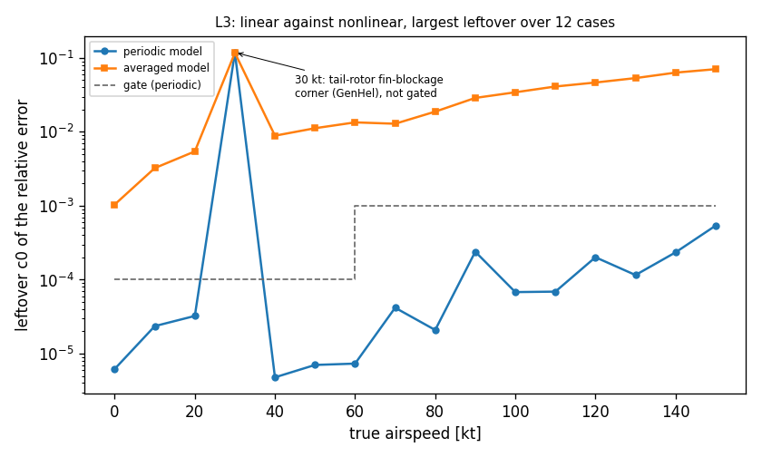

- *Periodic model:* ≤ 3.2e-5 up to 60 kt and ≤ 5.4e-4 above, except at 30 kt.
  - About half of the high-speed leftover is the held-body linearization. A linear model built about the free, vibrating flight halves it (comparison below).
  - The rest is the integration step. Stepping both models at the same rate (T/256 to 60 kt, T/512 above) took the 140 kt collective case from 1.1e-3 to 7e-5.
- *30 kt:* 12 % leftover, from GenHel's tail-rotor fin blockage (CR-166309 pp. 5.4-2, 5.4-8). The blockage factor rises as a parabola up to its breakpoint, exactly 30.0 kt ("empirical and based on flight test data of other helicopters"), and is flat above it, so a 30.0 kt trim sits on a corner. It isn't smoothed: no source gives the shape (D-035 notes, approved 2026-10-15). A linear model at exactly 30 kt holds the average of the two slopes, and one within about a knot of 30 kt is less reliable for speed changes across it.
- *Averaged model:* its leftover grows from 0.1 % in hover to 7 % at 150 kt. This is the periodicity it drops, as SPEC_REVIEW #29 predicted.
- *Amplitudes:* the largest amplitudes are chosen to stay clear of nearby map nodes. In hover the wake skew χ is −0.85°, next to the 0° node of the rotor-wash maps; at 60 kt the flapping a₁ is 0.12°, next to its 0° node. A 0.25 m/s perturbation crossed them.

**The averaging error and the periodic part.**

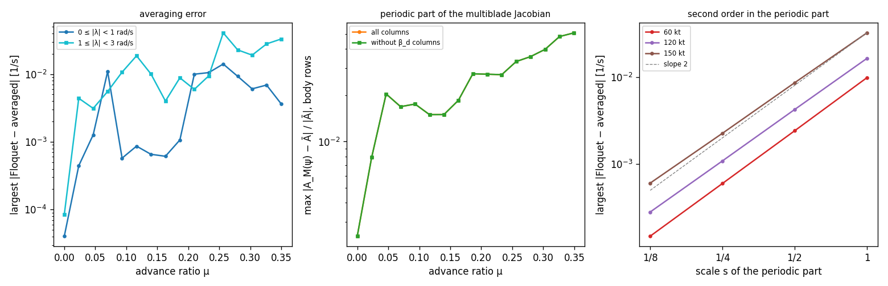

- *Left:* the largest gap between the averaged eigenvalues and the Floquet exponents of the free flow map.
  - Slow modes (|λ| < 1 rad/s): 4e-5 rad/s in hover, and 4e-4 to 4.4e-3 from 10 to 140 kt, growing with μ. The exceptions are 6.7e-3 at 30 kt, where the flow map's central differences straddle the blockage corner, and 0.028 at μ = 0.35 (150 kt), where a slow real root moves by 10 % (−0.269 to −0.241 rad/s).
  - Faster modes (1–3 rad/s): up to 0.04 rad/s at 40–50 kt, a root near −2.5 ± 0.8i where roll subsidence couples with the tail-wake lags. Johnson (p. 757) expects the approximation to be least satisfactory for faster, rotor-coupled modes.
  - M7c's comparison with identified models therefore reports the Floquet exponents alongside the averaged ones.
- *Middle:* the multiblade Jacobian's body rows vary around the revolution by 9 % already in hover, almost all in the differential-coning (β_d) columns. Their mean is zero; the 2/rev part comes from the trim's cyclic flapping (Johnson p. 557). Without those columns the variation is 0.14 % in hover and 3.9 % at 150 kt.
- *Right:* the gap with the periodic part scaled by s (J = 1024 samples, midpoint matrix exponentials) shrinks 3.7–4.9× per halving at 60, 120 and 150 kt: second order. This follows because the first-order change of a simple Floquet exponent is the revolution mean of the periodic part, which is zero (own perturbation argument, SPEC_REVIEW #29).

**The held-body shortcut.** The linear models are taken about the held trim orbit, while the free aircraft vibrates at 4/rev (M7a). Rebuilt about the free flight (its first and its third revolution, `m7b_heldfree.csv`):
- *Eigenvalues (|λ| < 3 rad/s):* they move by at most 1.3e-6 relative in hover, 6.7e-5 at 60 kt, 8.1e-5 at 120 kt, and 6.9e-4 rad/s (4.2e-3 relative) at 150 kt.
- *Key derivatives:* they move by 1.7e-6, 6.8e-5, 3.5e-4 and 2.9e-3. At 150 kt M_w is the exception, at 5 %: it is nearly zero there (5e-4, changing sign with speed), and its change is 2.5e-5 rad/(m·s).
- *How it compares:* the first and third revolutions differ from each other by as much, so this is the size of the shortcut's effect, well below the averaging error.

**The UH-60A's modes and derivatives.** ISA sea level, 16 638 lbm, condensed 6-DOF model (`m7b_modes.csv`, `m7b_derivatives.csv`):

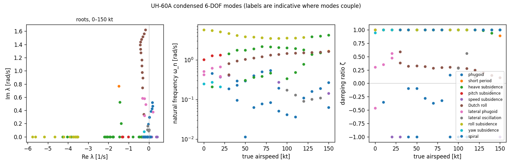

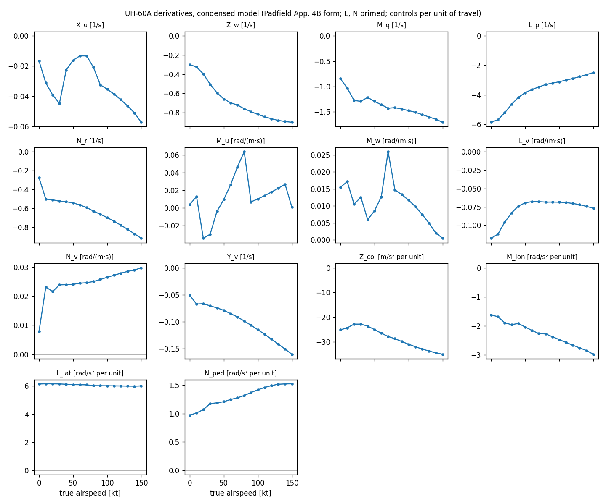

- *Hover:* coupled pitch–roll oscillations, one unstable (0.198 ± 0.374i, ω_n 0.42 rad/s, ζ = −0.47) and one lightly damped (−0.153 ± 0.485i); pitch subsidence −1.03, roll subsidence −5.87 and a heave–yaw pair −0.27 ± 0.07i (ζ = 0.97). L_p = −5.86 /s, Z_w = −0.30 /s, M_q = −0.85 /s.
- *Forward flight:* an unstable phugoid (0.157 ± 0.430i at 60 kt, 0.123 ± 0.358i at 120 kt), a Dutch roll (ζ ≈ 0.27–0.29, ω_n 1.0 rad/s at 60 kt and 1.46 at 120 kt), a stable spiral and roll subsidence. Labels are a heuristic from the eigenvectors, indicative where modes couple strongly.
- With speed, Z_w and M_q grow in magnitude, L_p falls and N_v grows; the control derivatives change little, except Z_col and M_lon, which grow. None of this is compared with data yet: the comparison with the UH-60's identified models (Fletcher, 1995), with Padfield's App. 4B trends and with the literature's mode character is M7c (D-035 V2).

**L4 beyond the gates** (`m7b_l4.csv`):
- *Heave:* the retained model's heave root differs from Z_w by 7 % and 14 % at the two weights. The Pitt–Peters inflow lag (τ = 0.16 s here) couples into heave, which the condensed model and Padfield's first-order heave mode leave out.
- *Pitch damping:* Eq. 4.81 leaves out the in-plane rotor loads (Padfield p. 197). They grow as the hub softens: 2.7 % at S_β = 0.15. On the centre-hinged hub (S_β = 0) the model's pitch damping even changes sign against the thrust-tilt estimate (+599 against −2531 N·m·s). The in-plane loads Padfield describes (the Amer effect, Eqs. 4.79–4.80, strongest at low thrust coefficient and high collective) act in that direction; Eq. 4.79 is derived for an untwisted rotor and isn't checked quantitatively here.

**Cost.** Linearizing the UH-60A (41 states, 64 azimuths) takes 25 ms, condensing 0.02 ms, and the Floquet flow map 0.25 s (Release, GCC 13.3, WSL2).

**Builds:** all 295 tests pass with GCC 13.3 (Debug) and Clang 18.1 (Debug), and all 294 in a Rocky Linux 9 container (GCC 11, Release; the CI job rehearsed in Docker with ccache). The new and changed tests (linearization, trim, airframe, tail-rotor wake; 43) pass under ASan+UBSan. clang-format is clean, and clang-tidy is clean on the changed `src/` files.

## M7c — Validation against Ballin and Fletcher (in progress, 2026-10-16)

Interim record of V1 (Ballin, NASA TM-88360, App. B Fig. B1; D-035 M7c amendment) so the investigations aren't repeated. The final M7c entry, with plots, comes at the milestone's end. Eyas runs are `uh60a_ballin.yaml` with D-038 and D-039, under GenHel's lateral constraint (zero roll from 50 kt); D-040 (the stabilator schedule on equivalent airspeed) came after most of the sideslip work and moves the zero-roll sideslip by at most 0.04°, so those numbers stand; the tables it changes are updated. The digitized panels (Figs. B1–B4) are all human-reviewed (DATA_GAPS.md); the gate is against the Sikorsky GenHel curves (D-035).

### Open: Eyas trims with right sideslip at zero roll

| kt | 60 | 80 | 100 | 120 | 140 | 160 |
|---|---|---|---|---|---|---|
| Eyas β [deg] | 5.89 | 3.98 | 3.29 | 3.07 | 3.11 | 3.39 |
| GenHel β [deg] (B1(f)) | 3.05 | 0.87 | −0.32 | −0.78 | −0.78 | −0.45 |

Trimmed at the flight test's sideslip with roll free, Eyas rolls left where the test rolled right (test roll from B1(e), unverified):

| kt | 49 | 73 | 95 | 118 | 140 | 163 |
|---|---|---|---|---|---|---|
| test β / φ [deg] | 0.9 / −0.2 | 0.4 / 0.1 | 0.8 / 0.8 | 1.1 / 1.7 | 0.6 / 1.5 | −1.3 / −0.8 |
| Eyas φ [deg] | −0.85 | −0.86 | −0.89 | −1.03 | −1.84 | −4.74 |
| W sin Δφ [lbf] | ≈ 180 | 270 | 470 | 760 | 930 | 1100 |

So Eyas carries a rightward side force (or lacks a leftward one) of ≈ 370 lbf at 100 kt against GenHel, growing with speed against the test. At these rolls ΣF_y = W sin φ ≠ 0, so the CG height enters the roll balance (Ballin's waterline question, DATA_GAPS.md) at about W sin φ × 1.39 ft ≈ 650 ft·lbf at 95 kt, of order 0.1° of roll.

Side-force budget at 100 kt, zero roll (β = 3.30°): main rotor −290 lbf, tail rotor +598, fuselage −263, fin −45, stabilator −1.

**Ruled out, each by a test:**
- *Main-rotor side force against theory.* Split by term (scratch instrumentation, 60/100/140 kt): lift tilted in-plane by the inflow angle −278/−253/−289 lbf, lift along the flapped normal −34/−23/−60, drag terms −6/−13/−62. The blade inertial terms (Coriolis, centrifugal, flap acceleration) sum to |F_y| < 10 lbf: a periodic blade's mass centre has zero mean acceleration. The lift part against Johnson (2013) Eqs. 6.75 and 6.85 evaluated at Eyas's own flapping, pitch and inflow harmonics, in wind axes, scaled by Eyas's thrust (Y/T, so the lift slope cancels): the closed form and the numerical integral agree to 0.1 lbf; adding Eyas's twist table, elastic twist, tip loss, root cutout, hinge offset and Pitt–Peters harmonics gives −246/−254/−295 lbf against Eyas's −274/−294/−372. The 10–20 % rest is the nonlinear, Mach-dependent airfoil tables, and goes the way GenHel needs. Eq. 6.85 is a difference of terms of 1000–3000 lbf, so the side force is sensitive to the rotor state, not to the force integration.
- *Lateral cyclic against GenHel.* θ1c computed for both models from all four plotted controls through the shared GenHel rigging (the offsets cancel, to the then-placeholder's ±0.2°): Eyas − GenHel within ±0.25° from 60 to 110 kt (−0.13° at 100 kt; with D-040), −0.4 to −1.6° at 120–160 kt. Tilting the disc for 370 lbf would take about 1.3°.
- *Wash-map inputs* (D-028; the maps use each model's own trimmed χ and a₁): a₁ ±1° and ±3°, χ ±2° and ±5°, wash ×0.9 and ×1.1 move β by ≤ 0.1°; removing the wash moves it 0.04° at 100 kt and 0.75° at 60 kt.
- *Blade lag* (Eyas has none, D-026): a self-consistent rigid lag probe moves β by +0.2 to +0.4° (wrong way); closing the gap would need ~14× the self-consistent 1/rev lag.
- *GenHel's inflow* (uniform with K_CM = K_CL = 0, as in the 1981 dataset): β +3.9°, worse. Uniform inflow: +4.15°.
- *Rotor variants at 100 kt:* yawed drag off 3.21°, elastic twist off 3.28°, 60 elements 3.32°, no tip loss 3.29°.
- *CG waterline* (WL 248.2 against 231.5 in): β 3.30 → 3.31°; at zero roll ΣF_y = 0, so CG height cancels.
- *Fin* reproduces GenHel Table 3.5.9 (C_L(0) = −0.06, about +45 lbf at β_v = 0, 100 kt). *Fuselage:* the side-force table is antisymmetric and the yaw table has N(0) = 0, so neither model has a lateral offset. *DNQD = 0* (DATA_GAPS.md): moving 370 lbf of tail-rotor thrust at the 33 ft arm needs about 12 000 ft·lbf, N/q ≈ 400 ft³ at 100 kt, comparable to the yaw map's extremes at 70–90°: not plausible near β = 0.
- *Tail rotor* against GenHel pp. 5.4-4 to 5.4-8 and *hub loads* against pp. 5.1-33 to 5.1-36: same equations; the 20° cant reading stands (DATA_GAPS.md). Yaw balance pins the tail-rotor thrust to within the main-rotor torque difference, a few % of ~28 000 ft·lbf over ~33 ft, i.e. 30–50 lbf of the 370.

**Pedal gap explained.** GenHel − Eyas pedal at zero roll grows from +0.8 % (60 kt) to +7.8 % (150 kt). Eyas's own dPedal/dβ (−0.6 to −1.4 %/deg, from its zero-sideslip and zero-roll trims) times the sideslip difference, plus the collective-to-tail-rotor mixing (16° θ0 per unit collective), leaves a residual within ±0.65 % at every speed to 160 kt (with D-040 and the corrected readings). It follows from the sideslip and collective; it isn't a separate defect.

**Status:** unexplained, recorded open. Since the force integration matches theory and the lateral cyclic matches GenHel, the difference is in the rotor state GenHel trims to or in a term of GenHel's not visible from its equations as read; the flight test (which flew rolled right) is the referee. Not chased further in M7c.

### Stabilator airspeed (D-040) and neutral longitudinal cyclic

**Stabilator.** Against Ballin's Sikorsky GenHel B1(h), Eyas's scheduled stabilator sat 1–4° low from 40 to 90 kt. GenHel's schedule (Fig. 5.1.7) evidently reads equivalent airspeed, as the aircraft's air-data sensors give it: fed GenHel's own collective, the schedule fits B1(h) to 0.61° rms on equivalent airspeed and 2.06° on true airspeed (5250 ft; at sea level they are the same). D-040 makes the change. Eyas − Sikorsky GenHel, 40–150 kt, rms (mean), before → after:

| | stabilator [deg] | longitudinal cyclic [%] | pitch [deg] | lateral cyclic [%] |
|---|---|---|---|---|
| true airspeed | 2.13 (−1.91) | 2.10 (−1.74) | 0.92 (+0.91) | 2.73 (+1.76) |
| equivalent airspeed | 0.77 (+0.06) | 0.57 (+0.14) | 0.40 (+0.27) | 2.43 (+1.37) |

Collective, sideslip, pedal and main-rotor power move by under 0.2 %, 0.04° and 2 hp.

**Neutral longitudinal cyclic.** Fitted to Ballin's GenHel longitudinal stick (B1(a), human-reviewed). Before D-040 the fit needed neutral at 2.06 in, 0.14 in beyond the range of GenHel's three Fig. 6.3.1 estimates (1.10–1.91 in), so the D-035 check failed; neutral was set at the pinned row's 1.91 in and 1.4 % of stick was recorded as an Eyas–GenHel pitch-trim difference. With D-040 the fit lands at 1.904 in, inside the range and 0.07 % of travel from 1.91 in; the check passes, and the residual is 0.64 % rms (largest 1.2 %), within the read-off accuracy: the 1.4 % was the stabilator's airspeed. With this neutral the cyclic offsets come out at −0.009° (θ1s) and +0.001° (θ1c), i.e. a centred stick gives a level swashplate.

### Pitch bias actuator

GenHel's PBA (Fig. 5.1.4) settles to −0.375 %/deg of pitch attitude plus 0.0525 %/kt above 80 kt, less 4.9 %, in percent of longitudinal stick travel, and in a trim it moves only the stick (the blade pitch, and so the trimmed state, are the same). With it on, Eyas's stick would sit 4.3 % aft of the Sikorsky GenHel curve with a 1.75 % rms shape error; with it off, −0.07 % and 0.64 %. The flight test agrees (off −0.4 %, on −4.4 %). V1 compares with it off (DECISIONS.md D-035).

### Climbs and descents (Figs. B2–B4)

Ballin's B2–B4 give no weight, CG or density altitude, and their level points differ from B1's (DATA_GAPS.md), so only the **change from level flight** against climb rate is compared, Eyas at B1's conditions. Sikorsky's GenHel held the stabilator at its level-flight value for each speed in these runs (Ballin p. 10); `eyas_m7c_cases` now writes both Eyas variants, `fixed_stabilator` (held at Eyas's own level incidence, through GenHel's STBSET override) and `genhel` (scheduled). Against the Sikorsky curves, holding the stabilator halves the longitudinal and pitch errors, as expected:

| rms of Eyas − Sikorsky change from level, −3 to +3 thousand ft/min | 60 kt | 100 kt | 137.5 kt |
|---|---|---|---|
| longitudinal cyclic [%], held / scheduled | 2.4 / 4.0 | 3.3 / 6.7 | 2.7 / 6.7 |
| pitch attitude [deg], held / scheduled | 0.26 / 0.84 | 0.38 / 1.05 | 0.69 / 1.39 |

With the stabilator held, against Sikorsky (rms; Eyas − GenHel at −3 / +3 thousand ft/min):

| | 60 kt | 100 kt | 137.5 kt |
|---|---|---|---|
| collective [%] | 1.4 (+3.4 / +0.4) | 2.5 (+6.0 / −0.3) | 3.7 (+9.2 / +1.4) |
| longitudinal cyclic [%] | 2.4 (−3.7 / +3.1) | 3.3 (−4.9 / +6.1) | 2.7 (−5.6 / +2.5) |
| lateral cyclic [%] | 1.6 (+0.7 / +3.2) | 2.7 (−2.4 / +5.3) | 4.6 (−5.0 / +9.5) |
| pedal [%] | 0.6 | 1.8 | 1.8 |
| pitch attitude [deg] | 0.26 | 0.38 | 0.69 |
| main-rotor power [hp] | 69 | 54 | 97 |

- *Power against climb rate* (slope over ±2000 ft/min, hp per 1000 ft/min): Eyas 465 / 479 / 521, Sikorsky 445 / 469 / 447, Ames 441 / 455 / 447, flight test 414 / 483 / 368 (four points each); W·V_c at 16 000 lbf is 485. At 60 and 100 kt Eyas is within 2–4 % of GenHel, so the unknown weight of B2–B4 can't be far from B1's; at 137.5 kt Eyas's slope is 14 % above GenHel's and above W·V_c. `Open.`
- *Collective in steep descent:* Eyas's collective falls less than GenHel's, by 3.4, 6.0 and 9.2 % at −3000 ft/min, growing with speed. `Open.`
- *Lateral cyclic in steep climb:* Eyas moves right of GenHel by 3.2, 5.3 and 9.5 % at +3000 ft/min. `Open.`
- These are trends at constant weight and density altitude of unknown value; the climb runs also sit at Eyas's level-flight sideslip, which differs from GenHel's (above).

### Open: hover power

Eyas 1537 hp main-rotor power at 0 kt against GenHel 1608 (B1(i)): induced 1210 hp equals ideal momentum (κ = 1.00), profile 325 hp, figure of merit 0.787.
- *ΔC_DMR = 0.002:* GenHel subtracts it (CR-166309 p. 5.1-27, re-read at 400 dpi; nomenclature p. 5.1-45 "Profile drag correction", no units). GenHel's profile power is therefore about 65 hp below Eyas's, leaving ≈ 140 hp of GenHel's power unexplained like for like.
- *Tip loss:* both models zero the lift outboard of B·R but take momentum inflow over the full disc. Leishman 2nd ed. §3.2.4 (Eqs. 3.36, 3.41) raises the induced velocity by 1/B: about +37 hp. Not adopted yet; a departure from GenHel toward the literature needing its own decision and an M5 recheck.
- *Ruled out:* fuselage download (334 lbf), stabilator download (−16 lbf), element count (within 5 hp).
- The real aircraft needs more power than both models at low speed (Ballin p. 10); the USAAEFA flight-test report (Project 79-24) would be the referee (DATA_GAPS.md).

Cruise main-rotor power is in D-039 (mean −45 hp against GenHel); with GenHel's uniform-plus-harmonic inflow it would be −10 hp mean against flight test (probe, not adopted; left to the V2 frequency responses).
